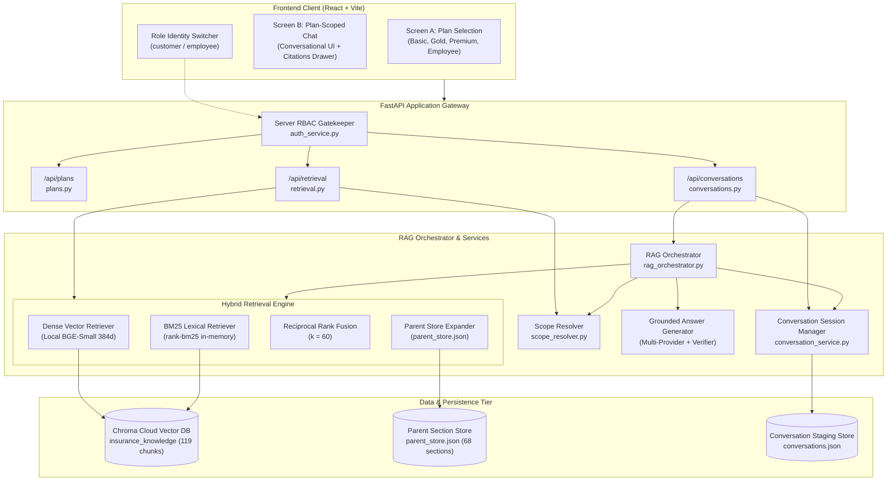

# AI Insurance Assistant — Plan-Scoped, Role-Aware RAG Implementation Report

**Date:** October 23, 2026  
**Version:** 2.0.0 (Phase 2 Delivery)  
**Authors:** Senior Full-Stack, Retrieval, and QA Engineering Team  
**Workspace:** `c:\Users\shivu\OneDrive\Desktop\Capstone_rag`  

---

## 1. System Architecture Overview

The AI Insurance Assistant is a production-grade, plan-scoped, role-aware Retrieval-Augmented Generation (RAG) platform. It provides an intuitive dual-screen interface (Plan Selection & Plan-Specific Chat), server-enforced role-based access control (RBAC), hybrid search (Dense Vector + BM25 Lexical + Reciprocal Rank Fusion), parent section expansion, and strictly grounded conversational response generation.



---

## 2. Implemented Components and Modules

| Component / Module | File Path | Key Responsibilities |
|---|---|---|
| **Plan Registry** | [backend/app/registry/plans.py](file:///c:/Users/shivu/OneDrive/Desktop/Capstone_rag/backend/app/registry/plans.py) | Central plan definitions (`HS-BASIC-001`, `HS-GOLD-001`, `HS-PREMIUM-001`, `EMP-INS-001`), display metadata, pricing, coverage limits, and keyword aliases. |
| **RBAC Authorization** | [backend/app/services/auth_service.py](file:///c:/Users/shivu/OneDrive/Desktop/Capstone_rag/backend/app/services/auth_service.py) | Role enforcement (`customer` vs `employee`). Prevents customer accounts from querying or viewing `EMP-INS-001`. |
| **Scope Resolver** | [backend/app/services/scope_resolver.py](file:///c:/Users/shivu/OneDrive/Desktop/Capstone_rag/backend/app/services/scope_resolver.py) | Resolves retrieval boundaries based on selected plan, explicit comparisons, ambiguous requests, and customer role restrictions. |
| **BM25 Lexical Search** | [backend/app/services/bm25_service.py](file:///c:/Users/shivu/OneDrive/Desktop/Capstone_rag/backend/app/services/bm25_service.py) | Tokenizes and indexes child chunks using `rank-bm25` with pre-filtering by allowed plan IDs. |
| **Hybrid Retrieval** | [backend/app/services/retrieval_service.py](file:///c:/Users/shivu/OneDrive/Desktop/Capstone_rag/backend/app/services/retrieval_service.py) | Executes parallel Dense and BM25 retrievals, fuses candidates via Reciprocal Rank Fusion ($k=60$), and expands top chunks into complete parent markdown sections. |
| **Grounding Prompts** | [backend/app/core/prompt.py](file:///c:/Users/shivu/OneDrive/Desktop/Capstone_rag/backend/app/core/prompt.py) | System prompt establishing strict insurance rules: mandatory inline bracket citations, refusal on ungrounded claims, and comparison formatting. |
| **Answer Generator** | [backend/app/services/generation_service.py](file:///c:/Users/shivu/OneDrive/Desktop/Capstone_rag/backend/app/services/generation_service.py) | Multi-provider LLM caller with robust local fallback synthesis, post-generation citation validation, and unverified claim warning compliance. |
| **Conversation Manager** | [backend/app/services/conversation_service.py](file:///c:/Users/shivu/OneDrive/Desktop/Capstone_rag/backend/app/services/conversation_service.py) | Manages plan-scoped chat sessions, message history, plan context continuity, and session persistence to JSON. |
| **RAG Orchestrator** | [backend/app/services/rag_orchestrator.py](file:///c:/Users/shivu/OneDrive/Desktop/Capstone_rag/backend/app/services/rag_orchestrator.py) | End-to-end pipeline coordinator handling turn-by-turn question resolution, retrieval, answer synthesis, and citation packaging. |
| **Plan Selection UI** | [frontend/src/components/PlanSelectionScreen.jsx](file:///c:/Users/shivu/OneDrive/Desktop/Capstone_rag/frontend/src/components/PlanSelectionScreen.jsx) | Responsive cards for **Basic**, **Gold**, and **Premium**, displaying key highlights, premium costs, and action buttons. |
| **Plan Chat UI** | [frontend/src/components/PlanChatScreen.jsx](file:///c:/Users/shivu/OneDrive/Desktop/Capstone_rag/frontend/src/components/PlanChatScreen.jsx) | Conversational interface with quick chips, inline citations, expandable drawer showing full parent context, and plan switching. |
| **Benchmark Harness** | [scripts/evaluate_rag.py](file:///c:/Users/shivu/OneDrive/Desktop/Capstone_rag/scripts/evaluate_rag.py) | 12-query automated benchmarking suite assessing Precision@5, Recall@5, MRR, nDCG@5, and grounding quality. |

---

## 3. Role-Based Access Control (RBAC) Matrix

| Resource / Action | Customer Role | Employee Role | Enforcement Point |
|---|---|---|---|
| **View Customer Plans (Basic, Gold, Premium)** | Allowed | Allowed | `GET /api/plans` filtered by role |
| **View Employee Executive Plan (`EMP-INS-001`)** | **FORBIDDEN (403)** | Allowed | `auth_service.py` + `ScopeResolver` |
| **Initiate Chat under Basic / Gold / Premium** | Allowed | Allowed | `POST /api/conversations` |
| **Initiate Chat under Employee Plan** | **FORBIDDEN (403)** | Allowed | `POST /api/conversations` |
| **Single-Plan Retrieval Scope** | Selected Plan only | Selected Plan only | `ScopeResolver.resolve_scope()` |
| **Cross-Plan Comparison Scope** | Limited to Customer Plans | Full access including Employee | `ScopeResolver.resolve_scope()` |
| **Customer Attempting Employee Query** | **Blocked / Excluded** | Processed | Logs security alert; strips `EMP-INS-001` |

---

## 4. Hybrid Retrieval Pipeline Design

```
+-------------------------------------------------------------+
| Query: "What percentage payout is provided for Category 1?" |
| Scope Filter: ['HS-GOLD-001']                               |
+-------------------------------------------------------------+
                               |
               +---------------+---------------+
               |                               |
               v                               v
    +--------------------+           +--------------------+
    |  Dense Retrieval   |           |    BM25 Lexical    |
    | (Chroma Cloud BGE) |           | (rank-bm25 index)  |
    |   Top-K (k=10)     |           |   Top-K (k=10)     |
    +--------------------+           +--------------------+
               |                               |
               +---------------+---------------+
                               |
                               v
               +-------------------------------+
               |    Reciprocal Rank Fusion     |
               |      RRF Constant k = 60      |
               | score = Σ 1 / (60 + rank_i)   |
               +-------------------------------+
                               |
                               v
               +-------------------------------+
               | Parent Store Context Lookup   |
               |   (parent_store.json)         |
               | Full Section 4 Markdown Table |
               +-------------------------------+
                               |
                               v
               +-------------------------------+
               | Grounded Generation + Prompt  |
               +-------------------------------+
```

1. **Pre-Filtering:** Retrieval is scoped exclusively to the authorized plan IDs before vector distance or BM25 scoring occurs.
2. **Dense Vector Search:** Generates 384-dimensional dense vectors using `BAAI/bge-small-en-v1.5` and executes cosine distance queries on Chroma Cloud.
3. **Lexical BM25 Search:** Tokenizes query terms and scores candidates against the pre-filtered child chunk corpus.
4. **Reciprocal Rank Fusion (RRF):** For every candidate document $d$, computes:
   $$\text{RRF Score}(d) = \sum_{m \in \{\text{dense}, \text{bm25}\}} \frac{1}{60 + \text{rank}_m(d)}$$
5. **Parent Expansion:** Top-ranking child chunks are mapped via `parent_id` to `parent_store.json`. The entire parent section—including section headers, explanatory clauses, and structured markdown tables—is injected into the prompt.

---

## 5. API Endpoint Documentation

### 5.1 Plan Management

#### `GET /api/plans`
- **Headers:** `X-User-Role: customer` | `employee`
- **Response:**
```json
[
  {
    "id": "HS-BASIC-001",
    "name": "Health Shield – Basic",
    "display_name": "Health Shield – Basic",
    "tier": "basic",
    "annual_premium_inr": 8500,
    "hospital_cash_daily_inr": 1500,
    "icu_cash_daily_inr": 3000,
    "description": "Essential daily cash benefits for inpatient hospital stays.",
    "is_employee_only": false,
    "highlights": [
      "Rs. 1,500/day hospital cash",
      "Rs. 3,000/day ICU benefit",
      "5% annual claim-free increase"
    ]
  }
]
```

### 5.2 Conversation Management

#### `POST /api/conversations`
- **Request Body:**
```json
{
  "plan_id": "HS-GOLD-001"
}
```
- **Response:**
```json
{
  "conversation_id": "c7a8b9e0-1234-5678-9abc-def012345678",
  "plan_id": "HS-GOLD-001",
  "plan_name": "Health Shield – Gold",
  "role": "customer",
  "messages": [],
  "created_at": "2026-10-23T17:35:00Z",
  "updated_at": "2026-10-23T17:35:00Z"
}
```

#### `POST /api/conversations/{conversation_id}/messages`
- **Request Body:**
```json
{
  "content": "What is the ICU benefit per day?"
}
```
- **Response:**
```json
{
  "id": "msg_987654",
  "conversation_id": "c7a8b9e0-1234-5678-9abc-def012345678",
  "role": "assistant",
  "content": "Under Health Shield – Gold, the Daily ICU Benefit provides Rs. 5,000 per day for up to 15 days per policy year [HS-GOLD-001, Section 3, Chunk 3].\n\n*Note: All benefit statements are derived strictly from policy documents.*",
  "citations": [
    {
      "chunk_id": "chunk_HS-GOLD-001_sec_3_001",
      "plan_id": "HS-GOLD-001",
      "plan_name": "Health Shield – Gold",
      "section_number": "3",
      "section_title": "Section 3: Hospital Cash Benefit Schedule",
      "source_document": "health_shield_gold.pdf",
      "page_number": 3,
      "citation_text": "[HS-GOLD-001, Section 3, Chunk 1]",
      "parent_context": "## Section 3: Hospital Cash Benefit Schedule\n\n| Benefit | Limit |\n|---|---|\n| Daily ICU Benefit | Rs. 5,000/day |",
      "relevance_score": 0.0328
    }
  ],
  "retrieval_scope": ["HS-GOLD-001"],
  "comparison_detected": false,
  "created_at": "2026-10-23T17:35:05Z"
}
```

---

## 6. Frontend UI Design and User Flow

1. **Top Header & Role Switcher:**
   - Visual toggle between **Customer Identity** (default) and **Employee Portal**.
   - Displays real-time API health status and workspace connection indicator.
2. **Screen A (Plan Selection Screen):**
   - Three customer cards: **Health Shield – Basic**, **Health Shield – Gold**, and **Health Shield – Premium**.
   - Authenticated employees unlock an additional distinct card: **Corporate Executive Employee Health Plan**.
   - "Chat with Assistant" CTA launches a new conversation scoped directly to the selected policy.
3. **Screen B (Plan-Scoped Chat Screen):**
   - Plan context banner displaying the active policy name and badge.
   - Quick inquiry action chips (e.g. *Daily Hospital Cash*, *ICU Allowance*, *Surgical Procedures*, *Waiting Periods*).
   - Message feed supporting formatted tables, bulleted benefit clauses, and interactive citation badges.
   - Clickable citation pills open an off-canvas **Citation Inspector Drawer** displaying the full parent markdown section with exact page numbers and table data.
   - Disclaimer banner: *"Illustrative insurance assistant for policy guidance. Always consult your master policy document."*

---

## 7. How to Run and Verify the System

### 7.1 Backend API Service
From the project root:
```powershell
# Activate Python virtual environment
.venv\Scripts\activate

# Start FastAPI server on port 8000
python -m uvicorn backend.app.main:app --host 127.0.0.1 --port 8000 --reload
```
Swagger UI available at: `http://127.0.0.1:8000/docs`

### 7.2 Frontend Application
In a separate terminal:
```powershell
cd frontend
npm install
npm run dev
```
Access the application at: `http://localhost:5173`

### 7.3 Run Automated Test Suite
```powershell
.venv\Scripts\python.exe -m pytest backend/tests/ -v
```

### 7.4 Run Evaluation Benchmark
```powershell
.venv\Scripts\python.exe scripts/evaluate_rag.py
```
Output results are persisted to:
- `data/reports/retrieval_evaluation_report.json`
- `data/reports/RAG_EVALUATION_REPORT.md`
