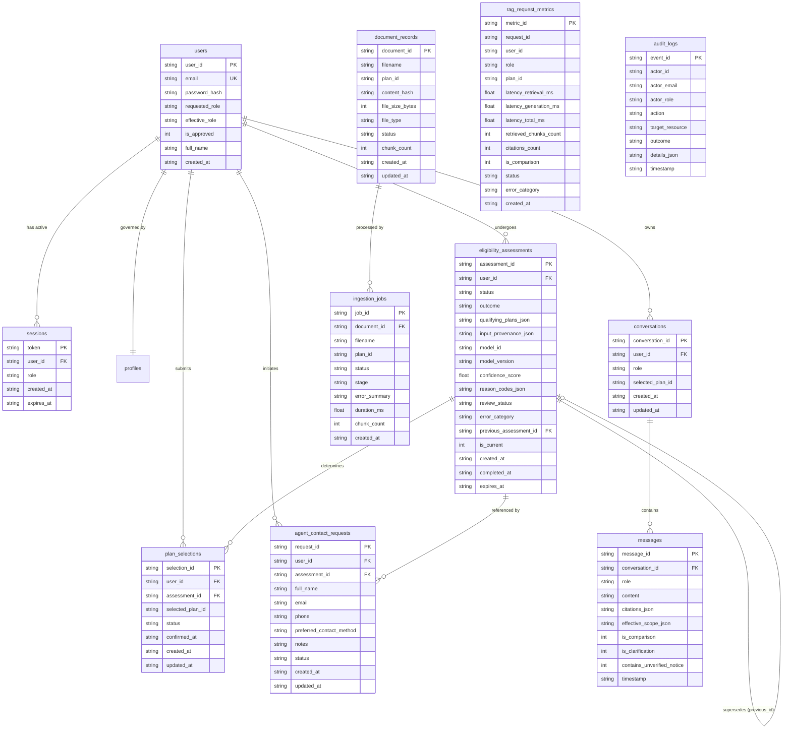

# Reference Manual: API Routes, Database Schema & Function Call Chains

**Project**: AI Health Insurance Assistant  
**Repository**: `shivakumarbhandari2003/Capstone-project`  
**Target Document**: Companion Document 4 of 5 (`docs/API_DATABASE_AND_FUNCTION_REFERENCE.md`)  
**Scope**: Complete Catalog of FastAPI Endpoints, Request/Response Schemas, Role Requirements, SQLite 12-Table Schema, Primary/Foreign Keys, 15 Indexes, and Detailed Function Call Chains.

---

## Table of Contents
1. [API Architecture & Global Configuration](#1-api-architecture--global-configuration)
2. [Complete REST API Catalog](#2-complete-rest-api-catalog)
   - [Authentication & User Management (`/api/auth`)](#authentication--user-management-apiauth)
   - [Conversations & RAG Chat (`/api/conversations`)](#conversations--rag-chat-apiconversations)
   - [Plan Catalog & Review (`/api/plans`)](#plan-catalog--review-apiplans)
   - [Underwriting Eligibility Assessment (`/api/eligibility`)](#underwriting-eligibility-assessment-apieligibility)
   - [ML Claim Predictor (`/api/claim-predictor`)](#ml-claim-predictor-apiclaim-predictor)
   - [Document Upload & Ingestion (`/api/upload`, `/api/ingestion`)](#document-upload--ingestion-apiupload-apiingestion)
   - [Retrieval Diagnostics (`/api/retrieval`)](#retrieval-diagnostics-apiretrieval)
   - [Admin Governance & Audit (`/api/admin`)](#admin-governance--audit-apiadmin)
3. [Relational Database Schema (SQLite 12-Table Specification)](#3-relational-database-schema-sqlite-12-table-specification)
   - [Entity-Relationship Architectural Diagram](#entity-relationship-architectural-diagram)
   - [Table 1: `users`](#table-1-users)
   - [Table 2: `sessions`](#table-2-sessions)
   - [Table 3: `profiles`](#table-3-profiles)
   - [Table 4: `conversations`](#table-4-conversations)
   - [Table 5: `messages`](#table-5-messages)
   - [Table 6: `document_records`](#table-6-document_records)
   - [Table 7: `ingestion_jobs`](#table-7-ingestion_jobs)
   - [Table 8: `rag_request_metrics`](#table-8-rag_request_metrics)
   - [Table 9: `audit_logs`](#table-9-audit_logs)
   - [Table 10: `eligibility_assessments`](#table-10-eligibility_assessments)
   - [Table 11: `plan_selections`](#table-11-plan_selections)
   - [Table 12: `agent_contact_requests`](#table-12-agent_contact_requests)
   - [Database Performance Indexes (15 Indexes)](#database-performance-indexes-15-indexes)
4. [End-to-End Function Call Chains](#4-end-to-end-function-call-chains)
   - [Call Chain 1: RAG Chat Turn Execution](#call-chain-1-rag-chat-turn-execution)
   - [Call Chain 2: Document Ingestion Pipeline](#call-chain-2-document-ingestion-pipeline)
   - [Call Chain 3: ML Claim Predictor Inference](#call-chain-3-ml-claim-predictor-inference)
   - [Call Chain 4: Eligibility Model Assessment](#call-chain-4-eligibility-model-assessment)
   - [Call Chain 5: Plan Confirmation & Review](#call-chain-5-plan-confirmation--review)
5. [Viva & Technical Interview Q&A on APIs and Database](#5-viva--technical-interview-qa-on-apis-and-database)

---

## 1. API Architecture & Global Configuration

The backend is built with **FastAPI** and mounts modular routers under the prefix `/api` configured via `settings.API_PREFIX` in [`backend/app/main.py`](file:///c:/Users/shivu/OneDrive/Desktop/Capstone_rag/backend/app/main.py).

### Global Middleware & Configuration
- **CORS Middleware**: Allows whitelisted frontend origins defined in `settings.CORS_ORIGINS` (default `http://localhost:5173`, `http://127.0.0.1:5173`) with credentials enabled.
- **Request ID Tracking**: Custom middleware injects a unique `X-Request-ID` into every HTTP transaction for end-to-end traceability across logs, metrics, and audit entries.
- **Global Error Handling**: Unhandled exceptions are intercepted by a global exception handler that logs the stack trace and returns a standardized JSON response:
  ```json
  {
    "detail": "An internal server error occurred. Please contact support with the request ID.",
    "request_id": "req_84f9b2d01a"
  }
  ```
- **Authentication Dependency**: FastAPI dependency injection via `get_current_user` and `require_role(...)` in [`backend/app/api/deps.py`](file:///c:/Users/shivu/OneDrive/Desktop/Capstone_rag/backend/app/api/deps.py).

---

## 2. Complete REST API Catalog

### Authentication & User Management (`/api/auth`)
*Source*: [`backend/app/api/routes/auth.py`](file:///c:/Users/shivu/OneDrive/Desktop/Capstone_rag/backend/app/api/routes/auth.py)

#### 1. `POST /api/auth/signup`
- **Purpose**: Registers a new customer, employee, or administrator account.
- **Access Level**: Public (No authentication required).
- **Request Body**: `SignupRequest`
  - `email`: Validated email string.
  - `password`: Plaintext password (minimum 8 characters).
  - `full_name`: User's full name.
  - `requested_role`: `"customer"`, `"employee"`, or `"admin"`.
- **Response**: `HTTP 201 Created` $\to$ `AuthResponse` (`access_token`, `token_type`, `user` object).
- **Service Invocation**: `AuthService.register_user(...)` $\to$ Bcrypt hash $\to$ SQLite `users` & `profiles` insert.

#### 2. `POST /api/auth/login`
- **Purpose**: Authenticates credentials and issues a signed JWT access token.
- **Access Level**: Public.
- **Request Body**: `LoginRequest` (`email`, `password`).
- **Response**: `HTTP 200 OK` $\to$ `AuthResponse` (`access_token`, `token_type`, `user` details).
- **Service Invocation**: `AuthService.authenticate_user(...)` $\to$ Verify bcrypt hash $\to$ Generate JWT $\to$ Record in `sessions` table $\to$ Update `profiles.last_login`.

#### 3. `POST /api/auth/logout`
- **Purpose**: Invalidates the active JWT session.
- **Access Level**: Authenticated (Requires valid Bearer token).
- **Response**: `HTTP 200 OK` $\to$ `{"message": "Logged out successfully."}`.
- **Service Invocation**: `sqlite_db.revoke_session(token)`.

#### 4. `GET /api/auth/me`
- **Purpose**: Returns the authenticated user's profile and effective plan.
- **Access Level**: Authenticated.
- **Response**: `HTTP 200 OK` $\to$ `UserProfileResponse` (`user_id`, `email`, `role`, `full_name`, `plan_id`).

---

### Conversations & RAG Chat (`/api/conversations`)
*Source*: [`backend/app/api/routes/conversations.py`](file:///c:/Users/shivu/OneDrive/Desktop/Capstone_rag/backend/app/api/routes/conversations.py)

#### 1. `GET /api/conversations`
- **Purpose**: Lists all conversation sessions owned by the authenticated user.
- **Access Level**: Authenticated.
- **Response**: `HTTP 200 OK` $\to$ `list[ConversationSummaryItem]`.

#### 2. `POST /api/conversations`
- **Purpose**: Creates a new plan-scoped chat conversation.
- **Access Level**: Authenticated.
- **Request Body**: `CreateConversationRequest` (`selected_plan_id`).
- **Response**: `HTTP 201 Created` $\to$ `ConversationResponse`.
- **Validation**: Ensures `selected_plan_id` belongs to the user's authorized role scope.

#### 3. `GET /api/conversations/{conversation_id}`
- **Purpose**: Fetches metadata for a specific conversation session.
- **Access Level**: Authenticated (Enforces conversation ownership: `user_id == current_user["user_id"]`).
- **Response**: `HTTP 200 OK` $\to$ `ConversationResponse`.

#### 4. `GET /api/conversations/{conversation_id}/messages`
- **Purpose**: Retrieves all chat turn messages (user and assistant) with citations.
- **Access Level**: Authenticated (Enforces conversation ownership).
- **Response**: `HTTP 200 OK` $\to$ `list[MessageResponse]`.

#### 5. `POST /api/conversations/{conversation_id}/messages`
- **Purpose**: Submits a user question, executes the hybrid RAG pipeline, and returns the grounded answer.
- **Access Level**: Authenticated.
- **Request Body**: `SendMessageRequest` (`content: str`).
- **Response**: `HTTP 200 OK` $\to$ `SendMessageResponse`:
  - `user_message`: Persisted user message object.
  - `assistant_message`: Generated answer, citations, status flags (`contains_unverified_notice`, `is_clarification`, `is_comparison`).
  - `effective_scope`: List of plan IDs queried during retrieval.
  - `metrics`: Latency breakdown (`retrieval_ms`, `generation_ms`, `total_ms`).

---

### Plan Catalog & Review (`/api/plans`)
*Source*: [`backend/app/api/routes/plans.py`](file:///c:/Users/shivu/OneDrive/Desktop/Capstone_rag/backend/app/api/routes/plans.py)

#### 1. `GET /api/plans`
- **Purpose**: Returns available insurance plans filtered by user role.
- **Access Level**: Public or Authenticated (Returns customer plans for anonymous/customer; includes `EMP-INS-001` for employees).
- **Response**: `HTTP 200 OK` $\to$ `PlanListResponse` (List of `PlanInfo` records).

#### 2. `GET /api/plans/{plan_id}/review-details`
- **Purpose**: Returns canonical rule-based benefits, sub-limits, deductibles, waiting periods, and exclusions.
- **Access Level**: Authenticated (Requires plan authorization).
- **Response**: `HTTP 200 OK` $\to$ Complete policy schedule and benefit specifications.
- **Service Invocation**: `PolicyReviewService.get_plan_review_details(plan_id)`.

---

### Underwriting Eligibility Assessment (`/api/eligibility`)
*Source*: [`backend/app/api/routes/eligibility.py`](file:///c:/Users/shivu/OneDrive/Desktop/Capstone_rag/backend/app/api/routes/eligibility.py)

#### 1. `POST /api/eligibility/assess`
- **Purpose**: Evaluates applicant biometrics against the Gradient Boosting underwriting classifier.
- **Access Level**: Authenticated.
- **Request Body**: `EligibilityAssessmentRequest` (`age`, `height_cm`, `weight_kg`, `smoking_status`, `pre_existing_conditions`, `exercise_frequency`).
- **Response**: `HTTP 200 OK` $\to$ `EligibilityAssessmentResponse` (`bmi`, `risk_tier`, `confidence_score`, `qualifying_plans`, `reason_codes`).
- **Service Invocation**: `EligibilityModelService.predict(...)` $\to$ Invalidate previous $\to$ Store in `eligibility_assessments`.

#### 2. `GET /api/eligibility/me`
- **Purpose**: Fetches the user's latest active eligibility assessment.
- **Access Level**: Authenticated.
- **Response**: `HTTP 200 OK` $\to$ `EligibilityAssessmentResponse`.

#### 3. `POST /api/eligibility/select-plan`
- **Purpose**: Records the user's chosen plan following underwriting assessment.
- **Access Level**: Authenticated.
- **Request Body**: `PlanSelectionRequest` (`assessment_id`, `plan_id`).
- **Response**: `HTTP 200 OK` $\to$ `PlanSelectionResponse`.

#### 4. `POST /api/eligibility/confirm-plan`
- **Purpose**: Confirms plan enrollment review, updates user's active plan, and records audit state.
- **Access Level**: Authenticated.
- **Request Body**: `PlanConfirmationRequest` (`selection_id`, `plan_id`).
- **Response**: `HTTP 200 OK` $\to$ `PlanConfirmationResponse`.

#### 5. `POST /api/eligibility/agent-contact`
- **Purpose**: Submits a request for human agent consultation or underwriting appeal.
- **Access Level**: Authenticated.
- **Request Body**: `AgentContactRequest` (`assessment_id`, `full_name`, `email`, `phone`, `preferred_contact_method`, `notes`).
- **Response**: `HTTP 201 Created` $\to$ Stored in `agent_contact_requests`.

---

### ML Claim Predictor (`/api/claim-predictor`)
*Source*: [`backend/app/api/routes/claim_predictor.py`](file:///c:/Users/shivu/OneDrive/Desktop/Capstone_rag/backend/app/api/routes/claim_predictor.py)

#### 1. `POST /api/claim-predictor/predict`
- **Purpose**: Predicts estimated claim payout using trained Linear Regression model and attaches retrieved policy grounds.
- **Access Level**: **Strictly Restricted to `employee` and `admin` roles** via `require_role(["employee", "admin"])`.
- **Request Body**: `ClaimPredictionRequest`
  - `plan`: Plan tier (`"Basic"`, `"Gold"`, `"Premium"`).
  - `claim_type`: Category (`"Major surgery"`, `"Daycare procedure"`, `"ICU hospitalization"`, etc.).
  - `age`: Applicant age (18–99).
  - `days_hospitalised`: Hospital stay duration in days (0–365).
  - `icu_days`: ICU duration in days (0–365).
  - `procedures_claimed`: Integer count of surgical procedures (1–10).
  - `prior_daycare_claims_year`: Integer count (0–20).
  - `extended_stay_flag`: Binary flag (`0` or `1`).
  - `pre_existing`: Binary string (`"yes"` or `"no"`).
  - `documents_complete`: Binary string (`"yes"` or `"no"`).
- **Response**: `HTTP 200 OK` $\to$ `ClaimPredictionResponse`
  - `prediction`: Float numerical estimate (bounded $\ge 0.0$).
  - `formatted_prediction`: Currency string (e.g. `"₹1,45,200.00"`).
  - `policy_grounding`: Concise RAG grounding extracted from policy terms.
  - `citations`: Single verified source citation object.
- **Service Invocation**: `ClaimPredictorService.predict_and_explain(...)`.

---

### Document Upload & Ingestion (`/api/upload`, `/api/ingestion`)
*Source*: [`backend/app/api/routes/upload.py`](file:///c:/Users/shivu/OneDrive/Desktop/Capstone_rag/backend/app/api/routes/upload.py), [`backend/app/api/routes/ingestion.py`](file:///c:/Users/shivu/OneDrive/Desktop/Capstone_rag/backend/app/api/routes/ingestion.py)

#### 1. `POST /api/upload` (and `POST /api/ingestion`)
- **Purpose**: Uploads a policy PDF and executes the 9-stage ingestion orchestrator.
- **Access Level**: **Admin Only** (`require_role(["admin"])`).
- **Request**: Multipart Form Data (`file: UploadFile`, `plan_id: str`).
- **Response**: `HTTP 200 OK` $\to$ `IngestionJobResponse` (`job_id`, `status`, `stages_completed`, `metrics`, `coverage_report`).

#### 2. `GET /api/ingestion/history`
- **Purpose**: Retrieves persistent ingestion run history across all past uploads.
- **Access Level**: Admin Only.
- **Response**: `HTTP 200 OK` $\to$ `list[HistoryItem]`.

#### 3. `GET /api/ingestion/{job_id}`
- **Purpose**: Returns real-time status and stage progress for an active or completed ingestion job.
- **Access Level**: Admin Only.
- **Response**: `HTTP 200 OK` $\to$ `IngestionJobResponse`.

---

### Retrieval Diagnostics (`/api/retrieval`)
*Source*: [`backend/app/api/routes/retrieval.py`](file:///c:/Users/shivu/OneDrive/Desktop/Capstone_rag/backend/app/api/routes/retrieval.py)

#### 1. `GET /api/retrieval/health`
- **Purpose**: Checks status of ChromaDB vector store, collection chunk count, and embedding model availability.
- **Access Level**: Public / Authenticated.
- **Response**: `HTTP 200 OK` $\to$ `RetrievalHealthResponse`.

#### 2. `POST /api/retrieval/search`
- **Purpose**: Raw diagnostic search endpoint executing hybrid retrieval and returning candidate chunks without LLM synthesis.
- **Access Level**: Admin Only.
- **Request Body**: `{"query": str, "top_k": int, "plan_id": Optional[str]}`.
- **Response**: `HTTP 200 OK` $\to$ Raw dense ranks, BM25 ranks, RRF scores, and parent metadata.

---

### Admin Governance & Audit (`/api/admin`)
*Source*: [`backend/app/api/routes/admin_dashboard.py`](file:///c:/Users/shivu/OneDrive/Desktop/Capstone_rag/backend/app/api/routes/admin_dashboard.py)

#### 1. `GET /api/admin/overview`
- **Purpose**: Aggregates enterprise metrics (total users, indexed documents, total chunks, average RAG latency, query counts).
- **Access Level**: Admin Only.
- **Response**: `HTTP 200 OK`.

#### 2. `GET /api/admin/users`
- **Purpose**: Lists registered users and profiles with governance status.
- **Access Level**: Admin Only.

#### 3. `GET /api/admin/documents`
- **Purpose**: Lists all ingested policy documents from SQLite `document_records`.
- **Access Level**: Admin Only.

#### 4. `POST /api/admin/documents/{document_id}/reindex`
- **Purpose**: Triggers vector reindexing and re-extracts chunks for an existing document.
- **Access Level**: Admin Only.

#### 5. `GET /api/admin/rag-metrics`
- **Purpose**: Retrieves recent RAG latency performance and error category telemetry from `rag_request_metrics`.
- **Access Level**: Admin Only.

#### 6. `GET /api/admin/audit-logs`
- **Purpose**: Fetches system security audit logs from SQLite `audit_logs` table.
- **Access Level**: Admin Only.

---

## 3. Relational Database Schema (SQLite 12-Table Specification)

### Entity-Relationship Architectural Diagram



---

### Table Specifications

#### Table 1: `users`
- **Purpose**: Master account authentication and authorization store.
- **Columns**:
  - `user_id` (TEXT, PK): Unique prefixed string (e.g. `usr_9f82a1c0de`).
  - `email` (TEXT, UNIQUE, NOT NULL, COLLATE NOCASE): User login email.
  - `password_hash` (TEXT, NOT NULL): 60-character bcrypt hash (`$2b$12$...`).
  - `requested_role` (TEXT, NOT NULL): Role requested at registration.
  - `effective_role` (TEXT, NOT NULL): Verified role (`customer`, `employee`, `admin`).
  - `is_approved` (INTEGER, NOT NULL, DEFAULT 1): Account activation flag.
  - `full_name` (TEXT): Display name.
  - `created_at` (TEXT, NOT NULL): ISO-8601 UTC timestamp.

#### Table 2: `sessions`
- **Purpose**: Active JWT token session registry enabling immediate logout revocation.
- **Columns**: `token` (TEXT, PK), `user_id` (TEXT, FK $\to$ `users.user_id`), `role` (TEXT), `created_at` (TEXT), `expires_at` (TEXT).

#### Table 3: `profiles`
- **Purpose**: User governance metadata and activity tracking.
- **Columns**: `user_id` (TEXT, PK, FK $\to$ `users.user_id`), `email` (TEXT), `role` (TEXT), `governance_status` (TEXT, DEFAULT `'active'`), `last_login` (TEXT).

#### Table 4: `conversations`
- **Purpose**: Plan-scoped chat session containers.
- **Columns**: `conversation_id` (TEXT, PK), `user_id` (TEXT, FK), `role` (TEXT), `selected_plan_id` (TEXT), `created_at` (TEXT), `updated_at` (TEXT).

#### Table 5: `messages`
- **Purpose**: Persisted chat turns with verified citations and provenance.
- **Columns**:
  - `message_id` (TEXT, PK): Unique message identifier.
  - `conversation_id` (TEXT, FK $\to$ `conversations.conversation_id` ON DELETE CASCADE).
  - `role` (TEXT, NOT NULL): `"user"` or `"assistant"`.
  - `content` (TEXT, NOT NULL): Sanitized text.
  - `citations_json` (TEXT, DEFAULT `'[]'`): Serialized JSON array of `SourceCitation` objects.
  - `effective_scope_json` (TEXT, DEFAULT `'[]'`): Serialized JSON array of queried plan IDs.
  - `is_comparison` (INTEGER, DEFAULT 0): Binary flag for multi-plan comparisons.
  - `is_clarification` (INTEGER, DEFAULT 0): Binary flag for ambiguity prompts.
  - `contains_unverified_notice` (INTEGER, DEFAULT 0): Binary flag for illustrative warnings.
  - `timestamp` (TEXT, NOT NULL): ISO-8601 UTC timestamp.

#### Table 6: `document_records`
- **Purpose**: Track ingested policy PDFs and their indexing status.
- **Columns**: `document_id` (TEXT, PK), `filename` (TEXT), `plan_id` (TEXT), `content_hash` (TEXT, SHA-256), `file_size_bytes` (INTEGER), `file_type` (TEXT), `status` (TEXT, DEFAULT `'INDEXED'`), `chunk_count` (INTEGER), `created_at` (TEXT), `updated_at` (TEXT).

#### Table 7: `ingestion_jobs`
- **Purpose**: Audit log of document ingestion executions and errors.
- **Columns**: `job_id` (TEXT, PK), `document_id` (TEXT, FK), `filename` (TEXT), `plan_id` (TEXT), `status` (TEXT), `stage` (TEXT), `error_summary` (TEXT), `duration_ms` (REAL), `chunk_count` (INTEGER), `created_at` (TEXT).

#### Table 8: `rag_request_metrics`
- **Purpose**: Performance and observability store tracking retrieval and generation latency.
- **Columns**: `metric_id` (TEXT, PK), `request_id` (TEXT), `user_id` (TEXT), `role` (TEXT), `plan_id` (TEXT), `latency_retrieval_ms` (REAL), `latency_generation_ms` (REAL), `latency_total_ms` (REAL), `retrieved_chunks_count` (INTEGER), `citations_count` (INTEGER), `is_comparison` (INTEGER), `status` (TEXT), `error_category` (TEXT), `created_at` (TEXT).

#### Table 9: `audit_logs`
- **Purpose**: Immutable security audit trail recording critical system events.
- **Columns**: `event_id` (TEXT, PK), `actor_id` (TEXT), `actor_email` (TEXT), `actor_role` (TEXT), `action` (TEXT), `target_resource` (TEXT), `outcome` (TEXT), `details_json` (TEXT), `timestamp` (TEXT).

#### Table 10: `eligibility_assessments`
- **Purpose**: Medical/demographic underwriting assessment records.
- **Columns**: `assessment_id` (TEXT, PK), `user_id` (TEXT, FK), `status` (TEXT), `outcome` (TEXT), `qualifying_plans_json` (TEXT), `input_provenance_json` (TEXT), `model_id` (TEXT), `model_version` (TEXT), `confidence_score` (REAL), `reason_codes_json` (TEXT), `review_status` (TEXT), `error_category` (TEXT), `previous_assessment_id` (TEXT, FK), `is_current` (INTEGER, DEFAULT 1), `created_at` (TEXT), `completed_at` (TEXT), `expires_at` (TEXT).

#### Table 11: `plan_selections`
- **Purpose**: User plan selection records tied to underwriting assessments.
- **Columns**: `selection_id` (TEXT, PK), `user_id` (TEXT, FK), `assessment_id` (TEXT, FK), `selected_plan_id` (TEXT), `status` (TEXT), `confirmed_at` (TEXT), `created_at` (TEXT), `updated_at` (TEXT).

#### Table 12: `agent_contact_requests`
- **Purpose**: Human callback and consultation requests.
- **Columns**: `request_id` (TEXT, PK), `user_id` (TEXT, FK), `assessment_id` (TEXT, FK), `full_name` (TEXT), `email` (TEXT), `phone` (TEXT), `preferred_contact_method` (TEXT), `notes` (TEXT), `status` (TEXT), `created_at` (TEXT), `updated_at` (TEXT).

---

### Database Performance Indexes (15 Indexes)
Configured in [`backend/app/db/sqlite_manager.py`](file:///c:/Users/shivu/OneDrive/Desktop/Capstone_rag/backend/app/db/sqlite_manager.py#L210-L224):
1. `idx_users_email` ON `users(email)`: $O(1)$ fast login authentication lookup.
2. `idx_sessions_token` ON `sessions(token)`: Instant session token validation.
3. `idx_conv_user` ON `conversations(user_id)`: Rapid conversation history retrieval for user dashboard.
4. `idx_msg_conv` ON `messages(conversation_id)`: Ordered chronological message loading.
5. `idx_docs_plan` ON `document_records(plan_id)`: Fast document lookup by insurance plan ID.
6. `idx_jobs_created` ON `ingestion_jobs(created_at)`: Chronological ordering of admin ingestion history.
7. `idx_rag_metrics_time` ON `rag_request_metrics(created_at)`: Time-series query optimization for admin dashboard latency charts.
8. `idx_audit_time` ON `audit_logs(timestamp)`: Security compliance log querying.
9. `idx_asmt_user_current` ON `eligibility_assessments(user_id, is_current)`: Instant retrieval of user's active underwriting assessment.
10. `idx_asmt_outcome` ON `eligibility_assessments(outcome)`: Aggregation of underwriting risk distribution.
11. `idx_asmt_status` ON `eligibility_assessments(status)`: Status filtering for pending assessments.
12. `idx_sel_user` ON `plan_selections(user_id)`: Active user enrollment lookup.
13. `idx_sel_asmt` ON `plan_selections(assessment_id)`: Linking assessment to selection.
14. `idx_contact_user` ON `agent_contact_requests(user_id)`: Contact request history per user.
15. `idx_contact_status` ON `agent_contact_requests(status)`: Administrative queue of pending agent callbacks.

---

## 4. End-to-End Function Call Chains

### Call Chain 1: RAG Chat Turn Execution
```
1. Client POST /api/conversations/{conversation_id}/messages
2. ──► conversations.py:send_message()
3.     ├──► deps.py:get_current_user() [Verifies Bearer JWT token & session]
4.     ├──► AuthorizationService.get_authorized_plans(role)
5.     ├──► ConversationService.get_conversation(conv_id) [Verifies ownership]
6.     └──► RAGOrchestrator.answer_query(...)
7.          ├──► InputGuardrail.validate_user_query(text) [NFC, Trojan Bidi, 28 Injection Regexes]
8.          ├──► ScopeResolver.resolve_scope(text, plan_id, role, history)
9.          │    └── Returns ScopeResolutionResult(effective_scope, is_comparison)
10.         ├──► HybridRetrievalService.retrieve(query, role, effective_scope, top_k=5)
11.         │    ├──► _dense_search() ──► ChromaDB collection.query(where={"plan_id": ...})
12.         │    ├──► BM25SearchService.search() ──► Rank-BM25 Okapi in-memory score
13.         │    ├──► _reciprocal_rank_fusion(dense, bm25, k=60)
14.         │    ├──► Deduplicate identical whitespace contents
15.         │    ├──► _expand_parents() ──► Lookup in parent_store.json
16.         │    └──► _build_context() ──► Assembles bounded context
17.         ├──► AnswerGenerationService.generate_answer(...)
18.         │    ├── If Gemini configured:
19.         │    │    └──► _call_gemini() ──► POST Generative Language API
20.         │    └── Else / On API failure:
21.         │         └──► _synthesize_grounded_answer() [Deterministic Extractive Fallback]
22.         ├──► OutputGuardrail.validate_citations_against_scope(...)
23.         ├──► OutputGuardrail.redact_secrets(answer_text)
24.         ├──► OutputGuardrail.sanitize_links(answer_text)
25.         ├──► ConversationService.add_message() ──► SQLite `messages` insert (User & Assistant)
26.         └──► sqlite_db.record_rag_metric() ──► SQLite `rag_request_metrics` insert
27. ◄── Return SendMessageResponse (HTTP 200 OK)
```

---

### Call Chain 2: Document Ingestion Pipeline
```
1. Client POST /api/upload
2. ──► upload.py:upload_file()
3.     ├──► deps.py:require_role(["admin"])
4.     ├──► Write UploadFile bytes to temporary file path
5.     └──► IngestionOrchestrator.run_pipeline(pdf_path, original_filename, plan_id)
6.          ├── Stage 1: compute_sha256(file_bytes) + Chroma check for duplicate
7.          ├── Stage 2: ValidationService.validate_document_identity(sample_text, plan_info)
8.          ├── Stage 3: PDFExtractor.extract_pdf_pages() + TableExtractor.extract_tables()
9.          ├── Stage 4: DocumentStructureParser.parse_document() + validate_extracted_structure()
10.         ├── Stage 5: ChunkingService.chunk_document() ──► Parents & Child Chunks
11.         ├── Stage 6: scan_text_for_document_poisoning() + validate_chunks_before_storage()
12.         ├── Stage 7: LocalEmbeddingService.generate_embeddings() ──► 384-dim BGE vectors
13.         ├── Stage 8: ChromaStorageService.staged_replace_document_chunks()
14.         │    ├── Delete existing chunks for filename
15.         │    ├── Upsert new vectors, documents, and metadata to ChromaDB
16.         │    └── Persist parent sections to data/parent_store.json
17.         ├── Stage 9: ChromaStorageService.verify_records_by_ids()
18.         ├──► _record_history()
19.         │    ├── Append to data/ingestion_history.json
20.         │    ├── sqlite_db.record_document() ──► SQLite `document_records`
21.         │    ├── sqlite_db.record_ingestion_job() ──► SQLite `ingestion_jobs`
22.         │    └── sqlite_db.record_audit_event() ──► SQLite `audit_logs`
23.         └──► rag_orchestrator.retrieval_service.refresh_indexes()
24.              ├── HybridRetrievalService reloads parent_store.json
25.              └── BM25SearchService.build_index() [Rebuilds BM25 index with new text]
26. ◄── Return IngestionJobResponse (HTTP 200 OK)
```

---

### Call Chain 3: ML Claim Predictor Inference
```
1. Client POST /api/claim-predictor/predict
2. ──► claim_predictor.py:predict_claim()
3.     ├──► deps.py:require_role(["employee", "admin"]) [Rejects customer with HTTP 403]
4.     ├──► Pydantic validation: ClaimPredictionRequest
5.     └──► ClaimPredictorService.predict_and_explain(request, role)
6.          ├──► ClaimPredictorService.predict(input_data)
7.          │    ├── Load insurance_claim_model.pkl & feature_columns.pkl
8.          │    ├── One-hot encode categorical features (plan, claim_type, pre_existing, etc.)
9.          │    ├── Align columns strictly to feature_columns.pkl (14 columns)
10.         │    ├── LinearRegression.predict(X)
11.         │    └── Apply non-negative bound: max(0.0, float(pred))
12.         ├──► HybridRetrievalService.retrieve(claim_type, role, [selected_plan_id], top_k=2)
13.         ├──► AnswerGenerationService.generate_claim_prediction_explanation(...)
14.         │    ├── Formats regression inputs & retrieved policy terms
15.         │    ├── Calls Gemini API or _synthesize_claim_prediction_explanation()
16.         │    └── Appends single verified citation: [{plan_name}, Section X, p. Y]
17.         └──► sqlite_db.record_audit_event("claim_prediction", ...)
18. ◄── Return ClaimPredictionResponse (HTTP 200 OK)
```

---

### Call Chain 4: Eligibility Model Assessment
```
1. Client POST /api/eligibility/assess
2. ──► eligibility.py:assess_eligibility()
3.     ├──► deps.py:get_current_user()
4.     ├──► Pydantic validation: EligibilityAssessmentRequest
5.     ├──► Calculate BMI = weight_kg / ((height_cm / 100) ** 2)
6.     └──► EligibilityModelService.predict(features)
7.          ├── Load eligibility_model.pkl (GradientBoostingClassifier)
8.          ├── Standardize numeric features & encode lifestyle factors
9.          ├── model.predict_proba(X) ──► Calibrate risk confidence score
10.         ├── Determine qualifying plan list based on risk tier
11.         ├── sqlite_db.invalidate_previous_assessments(user_id)
12.         ├── sqlite_db.record_eligibility_assessment(...) ──► SQLite `eligibility_assessments`
13.         └── sqlite_db.record_audit_event("eligibility_assessment", ...)
14. ◄── Return EligibilityAssessmentResponse (HTTP 200 OK)
```

---

### Call Chain 5: Plan Confirmation & Review
```
1. Client POST /api/eligibility/confirm-plan
2. ──► eligibility.py:confirm_plan()
3.     ├──► deps.py:get_current_user()
4.     ├──► sqlite_db.get_current_eligibility_assessment(user_id)
5.     ├──► Verify plan_id is among user's qualifying plans
6.     ├──► PolicyReviewService.get_plan_review_details(plan_id)
7.     │    └── Loads canonical rules (benefits, sub-limits, copays, exclusions)
8.     ├──► sqlite_db.record_plan_selection(status="ACTIVE", confirmed_at=now)
9.     ├──► sqlite_db.update_user_plan(user_id, plan_id) ──► Updates users.plan_id
10.    └──► sqlite_db.record_audit_event("plan_confirmation", ...)
11. ◄── Return PlanConfirmationResponse (HTTP 200 OK)
```

---

## 5. Viva & Technical Interview Q&A on APIs and Database

### Q1: Why did you choose SQLite with WAL mode instead of PostgreSQL for this project?
**Answer**: For this self-contained, enterprise AI assistant demonstration, SQLite eliminates external daemon dependencies, complex socket configuration, and cloud database billing while delivering exceptional single-node read/write performance. In default rollback journal mode, SQLite locks the entire database during writes. By enabling **Write-Ahead Logging (WAL)** (`PRAGMA journal_mode = WAL;`), writers append changes to a separate `-wal` file without blocking concurrent readers, and readers do not block writers. Combined with SQLite indexes on `user_id`, `token`, `conversation_id`, and `created_at`, average query latency remains below 2 milliseconds.

### Q2: Why is the Claim Predictor route restricted to employees and admins, and how is this enforced?
**Answer**: In health insurance operations, an ML claim cost estimation model calculates raw expected financial exposure based on statistical historical payouts. Exposing uninterpreted raw monetary predictions directly to retail customers can lead to severe legal and regulatory misunderstandings—such as customers assuming the statistical prediction represents a guaranteed claim authorization. Therefore, the route `/api/claim-predictor/predict` is strictly restricted to internal staff using FastAPI dependency injection:
```python
@router.post("/predict", dependencies=[Depends(require_role(["employee", "admin"]))])
```
If a customer attempts to invoke this endpoint, FastAPI intercepts the request and returns `HTTP 403 Forbidden` before any machine learning code executes.

### Q3: What is the relationship between ChromaDB, SQLite, and `parent_store.json`?
**Answer**: They form a complementary, three-tier storage architecture:
1. **ChromaDB**: The vector database storing child chunk texts (500–1000 characters), their 384-dimensional dense embeddings, and filtering metadata (`plan_id`, `section_number`). Used exclusively for semantic similarity search.
2. **`parent_store.json`**: An atomic JSON document store caching full, unchopped parent sections (titles, complete clauses, full benefit tables). When ChromaDB and BM25 retrieve relevant child chunks, the system looks up their `parent_id` in `parent_store.json` to expand context for the LLM.
3. **SQLite (`data/app.db`)**: The relational database of record storing relational business entities: user accounts, bcrypt password hashes, active sessions, conversation history, audit logs, RAG latency metrics, and underwriting assessments.

### Q4: How does your database ensure that a user cannot read another user's chat conversations?
**Answer**: Through server-side ownership verification. In `conversations.py`, every route retrieving or adding messages (`/{conversation_id}`, `/{conversation_id}/messages`) checks the conversation record in SQLite:
```python
conv = ConversationService.get_conversation(conversation_id)
if conv.user_id != current_user["user_id"] and current_user["role"] != "admin":
    raise HTTPException(status_code=403, detail="Access denied to conversation.")
```
Even if an authenticated user guesses or brute-forces another user's UUID `conversation_id`, the backend verifies that the requesting user's JWT `user_id` matches the conversation's owner, blocking unauthorized access.

### Q5: How do the 15 database indexes optimize end-to-end RAG response latency?
**Answer**: During a single chat turn, the backend performs multiple SQLite operations: authenticating the session token, loading the conversation, retrieving recent message history, saving user and assistant messages, and logging latency telemetry. Without indexes, each of these queries would trigger a full table scan ($O(N)$). With indexes on `sessions(token)`, `conversations(user_id)`, and `messages(conversation_id)`, query lookups are reduced to $O(\log N)$ B-tree traversals, taking less than 1 ms and ensuring that the database never becomes the bottleneck in the RAG pipeline.
