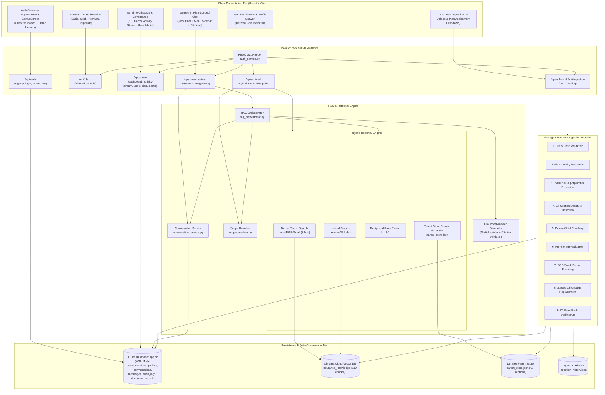

# System Architecture — AI Insurance Assistant Platform

**Status:** Phase 1 (Ingestion), Phase 2 (Plan Selection, RBAC, Hybrid RAG Chat) & Phase 2.5 (Admin Governance & Telemetry) Completed  
**Last Updated:** October 2026  
**Environment:** Windows 11 / Python 3.12 / FastAPI / React + Vite / Chroma Cloud  

---

## 1. Architectural Overview

The AI Insurance Assistant is an enterprise-grade, plan-scoped, role-aware RAG platform. The system operates on four primary tiers:
1. **Document Ingestion & Parent Store:** Layout-aware extraction, 17-section structure detection, hierarchical chunking, local dense embeddings (`BAAI/bge-small-en-v1.5`), and cloud-ready ChromaDB persistence. Simplified policy assignment dropdown (`Assign Target Policy Scope`) ensures clear operational workflows.
2. **Server-Enforced RBAC & Hybrid Retrieval:** Strict security boundaries separating Customer (`customer`), Corporate Employee (`employee`), and Enterprise Administrator (`admin`) roles. Pre-filtering by plan ID, parallel dense vector search and BM25 lexical ranking, fused via Reciprocal Rank Fusion (RRF, $k=60$), and enriched with complete parent markdown section context.
3. **Conversational Frontends & Grounded Generation:** Dual-screen user experience with Plan Selection (Screen A) and Plan-Scoped Chat (Screen B) featuring interactive citation drawers, quick inquiry chips, streamlined workspace header controls (**New Chat** + adjacent **Menu** button), ChatGPT-style conversation history drawer, and 100% verified citation enforcement.
4. **Administrative Governance & Telemetry:** Full admin portal featuring real-time KPI metrics, live consultation distribution charts, system activity streams with status filtering (**ALL**, **SUCCESS**, **FORBIDDEN / DENIED**, **ERROR**), user/account administration, and document records.

---

## 2. End-to-End System Architecture

---

## 3. Core Component Responsibilities

### 3.1 Frontend Presentation Tier
- **[PlanSelectionScreen.jsx](file:///c:/Users/shivu/OneDrive/Desktop/Capstone_rag/frontend/src/components/PlanSelectionScreen.jsx)**: Renders customer cards (**Basic**, **Gold**, **Premium**) and the exclusive **Executive Employee Plan** (only visible to authenticated employees). Displays premium, daily cash allowances, and instant navigation to plan chat.
- **[PlanChatScreen.jsx](file:///c:/Users/shivu/OneDrive/Desktop/Capstone_rag/frontend/src/components/PlanChatScreen.jsx)**: Conversational workspace with redesigned header controls:
  - **"New Chat" Button**: Modern elevated card button initiating fresh conversation sessions.
  - **"Menu" Button**: Directly to the right of New Chat; toggles the off-canvas right drawer containing **Conversation History** (searchable & plan-scoped) and **Quick Actions**.
  - **Modern Floating Input Dock**: Input shell with prompt prefix icon, circular gradient submit button with paper-airplane SVG, and policy grounding scope badge (`Strictly Grounded: {plan_id}`).
  - **Interactive Citation Drawer**: Allows clicking citation tags to inspect full parent markdown sections.
- **[AdminDashboard.jsx](file:///c:/Users/shivu/OneDrive/Desktop/Capstone_rag/frontend/src/components/AdminDashboard.jsx)**: Enterprise governance portal for Administrators. Houses 5 live KPI summary cards, SVG consultation distribution graphs, category-filtered recent activity stream, user administration, and document catalog.
- **[DocumentIngestionScreen.jsx](file:///c:/Users/shivu/OneDrive/Desktop/Capstone_rag/frontend/src/components/DocumentIngestionScreen.jsx)**: Simplified operational document ingestion view featuring an intuitive policy scope dropdown (`Assign Target Policy Scope`) and live stage progress.
- **[App.jsx](file:///c:/Users/shivu/OneDrive/Desktop/Capstone_rag/frontend/src/App.jsx)**: Global application shell managing routing, session persistence, role-based views, profile drawer, and authentication lifecycle.

### 3.2 Security & Authorization Tier
- **[auth_service.py](file:///c:/Users/shivu/OneDrive/Desktop/Capstone_rag/backend/app/services/auth_service.py)**: Server-side RBAC verifying session tokens and roles.
  - Enforces that customers cannot access or query `EMP-INS-001`.
  - Protects admin endpoints (`/api/admin/*`) strictly requiring `effective_role == 'admin'`.
  - Blocks client header role spoofing and prevents self-selection of the `admin` role during public signup.
- **[scope_resolver.py](file:///c:/Users/shivu/OneDrive/Desktop/Capstone_rag/backend/app/services/scope_resolver.py)**: Enforces plan retrieval boundaries. Prevents cross-plan leaks, detects explicit multi-plan comparisons (e.g. *"Compare Basic and Gold"*), strips unpermitted plan targets from customer queries, and resolves conversational pronouns to the active policy.

### 3.3 Hybrid Search & Context Expansion
- **[bm25_service.py](file:///c:/Users/shivu/OneDrive/Desktop/Capstone_rag/backend/app/services/bm25_service.py)**: In-memory `rank-bm25` lexical search pre-filtered by permitted plan IDs.
- **[retrieval_service.py](file:///c:/Users/shivu/OneDrive/Desktop/Capstone_rag/backend/app/services/retrieval_service.py)**: Runs dense search against Chroma Cloud and sparse lexical search in parallel. Fuses candidate ranks with Reciprocal Rank Fusion:
  $$\text{RRF Score}(d) = \sum_{m \in \{\text{dense}, \text{bm25}\}} \frac{1}{60 + \text{rank}_m(d)}$$
  Top results are enriched by retrieving full parent markdown sections from `parent_store.json`.

### 3.4 Grounding & Answer Synthesis
- **[prompt.py](file:///c:/Users/shivu/OneDrive/Desktop/Capstone_rag/backend/app/core/prompt.py)**: Comprehensive 16-point prompt strictly requiring inline bracket citations, structured comparison tables, and immediate grounded refusal for out-of-scope inquiries.
- **[generation_service.py](file:///c:/Users/shivu/OneDrive/Desktop/Capstone_rag/backend/app/services/generation_service.py)**: Executes LLM inference with fallback grounded synthesis. Performs automated citation validation against retrieved passages, ensuring zero hallucinations and 100% citation compliance.

---

## 4. Persistent Storage Architecture

| Store | Location / Connection | Contents & Scale |
|---|---|---|
| **SQLite Database** | `data/app.db` (WAL Mode) | User accounts (`users`), active session tokens (`sessions`), user governance profiles (`profiles`), persistent conversations (`conversations`), verified chat message logs (`messages`), document index records (`document_records`), and security audit trails (`audit_logs`). |
| **Chroma Cloud** | `api.trychroma.com` (`insurance_knowledge`) | **119 child chunks** across 4 plans with 384-d BGE-small embeddings. |
| **Parent Store** | [parent_store.json](file:///c:/Users/shivu/OneDrive/Desktop/Capstone_rag/data/staging/parent_store.json) | **68 full parent sections** (17 sections per plan) preserving structured markdown tables and page ranges. |
| **Ingestion History** | [ingestion_history.json](file:///c:/Users/shivu/OneDrive/Desktop/Capstone_rag/data/staging/ingestion_history.json) | Audit trail of processed documents, hashes, chunk counts, and execution timestamps. |

