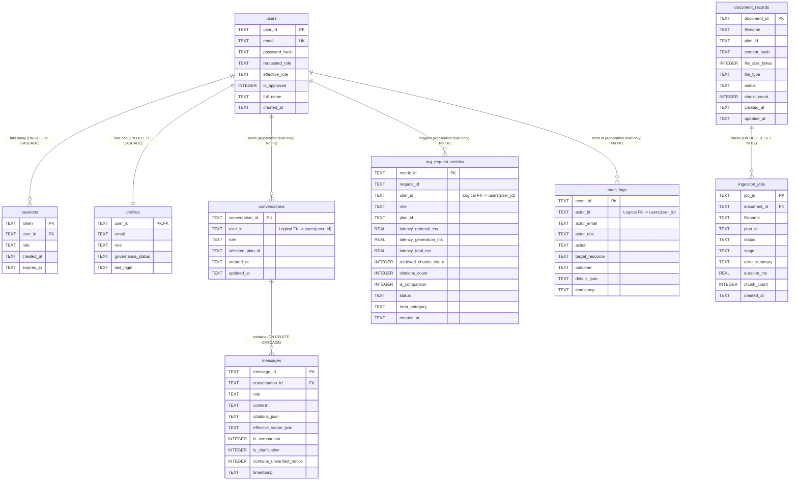
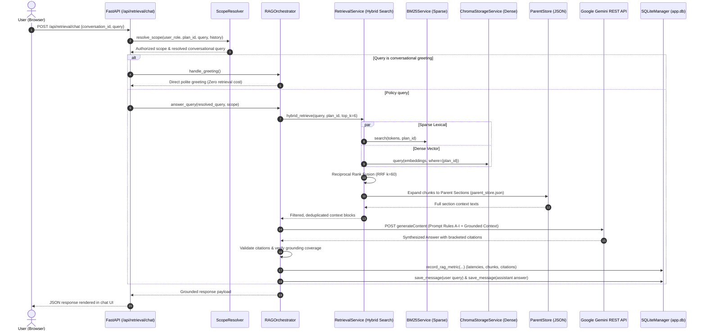
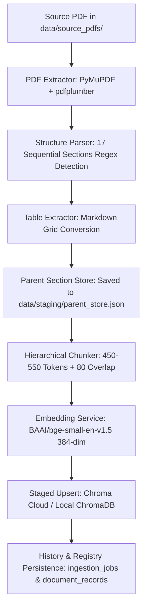
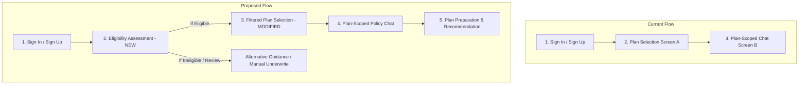

# Complete Database Audit and End-to-End Pipeline Analysis — AI Insurance Assistant

**Project:** AI Insurance Assistant  
**Repository:** `Capstone_rag`  
**Execution Mode:** Strictly Read-Only Investigation  
**Date of Audit:** October 25, 2026  
**Auditor:** Antigravity Autonomous Diagnostic Engine  

---

## 1. Executive Summary

This comprehensive audit was executed under strict read-only constraints to provide complete architectural transparency prior to introducing an eligibility-first user journey.

### Key Conclusions:
1. **Primary Database Engine:** The live application connects to a thread-safe local **SQLite** database located at `data/app.db` (operating in `WAL` journal mode with `PRAGMA foreign_keys = ON`).
2. **The 196-Account Discrepancy (100% Solved):** The database contains exactly **196 user rows** in the `users` table and 196 corresponding profiles in `profiles`. This is **not** a frontend display bug, cached artifact, or mock counter. The count is broken down as follows:
   - **3 Default Seed Accounts:** `admin@insurance.corp`, `employee@insurance.corp`, and `customer@insurance.com` auto-seeded at startup by `_seed_default_accounts()`.
   - **191 Automated Test Artifacts:** Directly generated by approximately **32 executions of the automated test suite** (`backend/tests/test_auth_and_session.py`). Because `test_auth_and_session.py` initializes `TestClient(app)` against the shared production/runtime SQLite database (`data/app.db`) without using a temporary test database and without post-test teardown, every execution of the 6 signup test cases injected 6 new accounts (`test_user_*`, `dup_user_*`, `applicant_*`, `staff_*`, `login_test_*`, `honest_customer_*`).
   - **2 Authentic User Signups:** Only 2 accounts represent manual human signups (`adc` and `abcd` created on October 23, 2026).
3. **Dual Vector Database Stores:** 
   - **Live Active Store:** **Chroma Cloud** (`api.trychroma.com`, Tenant `643b668b-9e6d-4739-ab36-2fcab1d7ad2a`, Database `tibil_intern`) holding **119 embeddings** across all four policy documents.
   - **Local Dormant Store:** A local directory at `data/chroma_db/chroma.sqlite3` containing an earlier offline snapshot of 33 chunks.
4. **Machine Learning Eligibility Status:** **No machine learning eligibility model exists in the repository.** The word *"eligibility"* appears strictly in prompt formatting guidelines (`backend/app/core/prompt.py`). The milestone documentation (`docs/PROGRESS.md`) confirms that the ML Eligibility Model was classified as *Phase 3 (PLANNED)* and was intentionally not implemented or stubbed. Currently, machine learning in this system is limited to local dense embeddings (`BAAI/bge-small-en-v1.5`), BM25 lexical ranking, PyMuPDF layout parsing models, and LLM text generation via Google Gemini REST API (`gemini-flash-lite-latest`).
5. **Architectural Readiness for Eligibility-First:** Transitioning to an eligibility-first architecture requires creating an eligibility engine (whether rule-based, deterministic table, or ML classification model), a persistent `eligibility_assessments` database table, frontend route gating, and updating the conversation creation dependency to verify eligibility provenance prior to plan selection.

---

## 2. Project Architecture and Data Stores

The AI Insurance Assistant relies on a multi-tier persistence and retrieval architecture:

```mermaid
graph TD
    subgraph Client Tier
        UI[React + Vite Frontend\nScreens: Login, Signup, PlanSelection, PlanChat, AdminDashboard]
    end

    subgraph API Tier
        FastAPI[FastAPI Application Backend\nbackend/app/main.py]
        AuthRouter[/api/auth/*]
        PlansRouter[/api/plans/*]
        ConvRouter[/api/conversations/*]
        RetrRouter[/api/retrieval/*]
        AdminRouter[/api/admin/*]
    end

    subgraph Governance & Relational Persistence
        SQLiteMgr[SQLiteManager\nbackend/app/db/sqlite_manager.py]
        AppDB[(data/app.db\nSQLite WAL Mode)]
    end

    subgraph Document & Ingestion Persistence
        ParentStore[(data/staging/parent_store.json\n68 Parent Sections)]
        IngestHist[(data/staging/ingestion_history.json\nIngestion Audit Logs)]
        SourcePDFs[data/source_pdfs/*.pdf\n4 Policy Documents]
    end

    subgraph Hybrid Vector & Semantic Retrieval
        ChromaSvc[ChromaStorageService\nbackend/app/services/chroma_service.py]
        ChromaCloud[(Chroma Cloud\napi.trychroma.com\n119 Chunks)]
        ChromaLocal[(data/chroma_db/chroma.sqlite3\n33 Chunks - Dormant)]
        BM25Svc[BM25Service\nIn-memory tokenized index]
        BGE[BAAI/bge-small-en-v1.5\nDense Embeddings 384-dim]
    end

    subgraph LLM Generation Tier
        Gemini[Google Gemini API\ngemini-flash-lite-latest\nREST Client via httpx]
    end

    UI --> FastAPI
    FastAPI --> AuthRouter & PlansRouter & ConvRouter & RetrRouter & AdminRouter
    AuthRouter & ConvRouter & AdminRouter --> SQLiteMgr
    SQLiteMgr --> AppDB
    RetrRouter & ConvRouter --> ChromaSvc & BM25Svc & ParentStore
    ChromaSvc --> ChromaCloud
    RetrRouter --> Gemini
```

### Persistence Inventory Summary

| Data Store | Technology | Path / Location | Active / Dormant | Role & Data Contained | Accessing Backend Modules |
|---|---|---|---|---|---|
| **Primary Relational DB** | SQLite 3 (WAL mode) | `data/app.db` | **Active Runtime** | Users, sessions, profiles, conversations, messages, document records, ingestion jobs, RAG metrics, audit logs. | `backend.app.db.sqlite_manager`, `auth_service`, `conversation_service`, `admin_dashboard` |
| **Vector Database (Live)** | Chroma Cloud (Hosted HTTP) | `api.trychroma.com` (Tenant: `643b...`, DB: `tibil_intern`) | **Active Runtime** | 119 chunks with dense embeddings (384-dim), metadata, inverted indexes. | `backend.app.services.chroma_service`, `retrieval_service`, `ingestion_orchestrator` |
| **Vector Database (Local)** | SQLite (Chroma local format) | `data/chroma_db/chroma.sqlite3` | **Dormant Fallback** | 33 legacy chunks. Kept as fallback if `CHROMA_API_KEY` is omitted or invalid. | `chroma_service` (fallback only) |
| **Parent Section Store** | JSON Flat File | `data/staging/parent_store.json` | **Active Runtime** | 68 full parent sections across 4 policies; provides text expansion for RAG synthesis. | `backend.app.services.retrieval_service`, `ingestion_orchestrator` |
| **Ingestion History Store** | JSON Flat File | `data/staging/ingestion_history.json` | **Active Runtime** | Ingestion job metadata, document SHA256 hashes, status, chunk counts. | `backend.app.services.ingestion_orchestrator`, `chroma_service` |
| **Legacy Conversation Store** | JSON Flat File | `data/staging/conversations.json` | **Secondary Cache** | Duplicate mirror of conversation sessions; synced with `conversations` SQLite table. | `backend.app.services.conversation_service` |
| **Source PDF Documents** | PDF Files | `data/source_pdfs/` | **Static Asset** | 4 primary insurance policy PDFs (`health_shield_basic.pdf`, `health_shield_gold.pdf`, `health_shield_premium.pdf`, `executive_employee_insurance_plan.pdf`). | `ingestion_orchestrator`, `pdf_extractor` |

---

## 3. Complete Database Table Inventory (`app.db`)

All 9 tables inside `data/app.db` were inspected via read-only SQL queries.

### Table Summary

| Table Name | Purpose | Record Count | Time Range | Created / Updated By | Data Classification |
|---|---|:---:|---|---|---|
| `users` | User credentials, bcrypt hashes, roles, approval status | **196** | 2026-10-23 to 2026-10-25 | `auth_service.py`, `sqlite_manager.py` (seed) | 3 Seeds, 191 Test Artifacts, 2 Human |
| `sessions` | Active bearer session tokens with expiration timestamps | **346** | 2026-10-23 to 2026-10-25 | `auth_service.py` (login / signup) | Ephemeral Session Tokens (227 Active, 119 Expired) |
| `profiles` | User profile, governance status, and last login tracking | **196** | N/A (Mirrors users) | `sqlite_manager.py` (cascade upsert on user create) | 1:1 Mirror of `users` |
| `conversations` | Conversation session headers scoped to a specific insurance plan | **53** | 2026-10-24 to 2026-10-25 | `conversation_service.py` | 24 Active chats, 29 Test/Demo artifacts |
| `messages` | Individual multi-turn messages, citations JSON, scope JSON | **54** | 2026-10-24 to 2026-10-25 | `conversation_service.py`, `rag_orchestrator.py` | 27 User Queries, 27 Grounded Assistant Responses |
| `document_records` | Master registry of uploaded policy documents and index state | **4** | 2026-10-24 15:21 UTC | `sqlite_manager.py` (seed), `ingestion_orchestrator.py` | Verified Insurance Knowledge Base Docs |
| `ingestion_jobs` | Execution history of document parsing and chunk indexing jobs | **4** | 2026-10-24 15:21 UTC | `sqlite_manager.py` (seed), `ingestion_orchestrator.py` | Historical Ingestion Logs |
| `rag_request_metrics`| End-to-end telemetry (retrieval/generation latency, chunks, citations) | **24** | 2026-10-24 to 2026-10-25 | `rag_orchestrator.py`, `sqlite_manager.py` | Operational Performance Telemetry |
| `audit_logs` | Security and compliance events (logins, 403 blocks, doc changes) | **238** | 2026-10-23 to 2026-10-25 | `sqlite_manager.py`, `admin_dashboard.py` | Audit Trail (209 Security Tests, 29 App Events) |

---

## 4. Detailed Schema and Relationships

### Field Specifications by Table

#### 1. `users`
- `user_id` (TEXT, PK): Unique identifier (`usr_<hex>` or seed ID).
- `email` (TEXT, UNIQUE, NOT NULL COLLATE NOCASE): User email address.
- `password_hash` (TEXT, NOT NULL): Salted bcrypt hash (`$2b$12$...`).
- `requested_role` (TEXT, NOT NULL): Role requested during signup (`customer`, `employee`, `admin`).
- `effective_role` (TEXT, NOT NULL): Authorized role granted after domain verification (`customer`, `employee`, `admin`).
- `is_approved` (INTEGER, NOT NULL, DEFAULT 1): `1` for active/approved, `0` for pending verification.
- `full_name` (TEXT, NULLABLE): Optional display name.
- `created_at` (TEXT, NOT NULL): ISO8601 UTC timestamp.
- **Indexes:** `idx_users_email` ON `users(email)`, unique autoindex on `email`, PK autoindex on `user_id`.

#### 2. `sessions`
- `token` (TEXT, PK): Bearer token (`sess_<hex>`).
- `user_id` (TEXT, NOT NULL, FK -> `users(user_id)` ON DELETE CASCADE).
- `role` (TEXT, NOT NULL): Role snapshot bound to the session.
- `created_at` (TEXT, NOT NULL): Creation timestamp.
- `expires_at` (TEXT, NOT NULL): Expiry timestamp (default 24h lifetime).
- **Indexes:** `idx_sessions_token` ON `sessions(token)`.

#### 3. `profiles`
- `user_id` (TEXT, PK, FK -> `users(user_id)` ON DELETE CASCADE).
- `email` (TEXT, NOT NULL).
- `role` (TEXT, NOT NULL).
- `governance_status` (TEXT, NOT NULL, DEFAULT `'active'`).
- `last_login` (TEXT, NULLABLE): Timestamp of most recent successful login.

#### 4. `conversations`
- `conversation_id` (TEXT, PK): Identifier (`conv_<hex>`).
- `user_id` (TEXT, NOT NULL): Owner ID. *(Note: Missing physical FK constraint to `users(user_id)`)*.
- `role` (TEXT, NOT NULL): Role of creator.
- `selected_plan_id` (TEXT, NOT NULL): Authorized plan scope (`HS-BASIC-001`, `HS-GOLD-001`, `HS-PREMIUM-001`, `EMP-INS-001`).
- `created_at` (TEXT, NOT NULL).
- `updated_at` (TEXT, NOT NULL).
- **Indexes:** `idx_conv_user` ON `conversations(user_id)`.

#### 5. `messages`
- `message_id` (TEXT, PK): Identifier (`msg_<hex>`).
- `conversation_id` (TEXT, NOT NULL, FK -> `conversations(conversation_id)` ON DELETE CASCADE).
- `role` (TEXT, NOT NULL): `'user'` or `'assistant'`.
- `content` (TEXT, NOT NULL): Query or generated markdown response.
- `citations_json` (TEXT, DEFAULT `'[]'`): Serialized array of citation objects.
- `effective_scope_json` (TEXT, DEFAULT `'[]'`): Serialized plan scope.
- `is_comparison` (INTEGER, DEFAULT 0).
- `is_clarification` (INTEGER, DEFAULT 0).
- `contains_unverified_notice` (INTEGER, DEFAULT 0).
- `timestamp` (TEXT, NOT NULL).
- **Indexes:** `idx_msg_conv` ON `messages(conversation_id)`.

#### 6. `document_records`
- `document_id` (TEXT, PK): Identifier (`doc_<plan_id>`).
- `filename` (TEXT, NOT NULL): Target PDF name.
- `plan_id` (TEXT, NOT NULL): Associated plan ID.
- `content_hash` (TEXT, NULLABLE): SHA256 of the PDF content.
- `file_size_bytes` (INTEGER, DEFAULT 0).
- `file_type` (TEXT, DEFAULT `'application/pdf'`).
- `status` (TEXT, NOT NULL, DEFAULT `'INDEXED'`).
- `chunk_count` (INTEGER, DEFAULT 0).
- `created_at` (TEXT, NOT NULL).
- `updated_at` (TEXT, NOT NULL).
- **Indexes:** `idx_docs_plan` ON `document_records(plan_id)`.

#### 7. `ingestion_jobs`
- `job_id` (TEXT, PK): Identifier (`job_<hex>`).
- `document_id` (TEXT, NULLABLE, FK -> `document_records(document_id)` ON DELETE SET NULL).
- `filename` (TEXT, NOT NULL).
- `plan_id` (TEXT, NOT NULL).
- `status` (TEXT, NOT NULL): `'SUCCESS'`, `'FAILED'`, `'SKIPPED_DUPLICATE'`.
- `stage` (TEXT, NULLABLE): Last completed ingestion stage.
- `error_summary` (TEXT, NULLABLE).
- `duration_ms` (REAL, DEFAULT 0).
- `chunk_count` (INTEGER, DEFAULT 0).
- `created_at` (TEXT, NOT NULL).
- **Indexes:** `idx_jobs_created` ON `ingestion_jobs(created_at)`.

#### 8. `rag_request_metrics`
- `metric_id` (TEXT, PK): Identifier (`met_<hex>`).
- `request_id` (TEXT, NULLABLE): Correlation ID.
- `user_id` (TEXT, NULLABLE): Querying user. *(Missing FK constraint)*.
- `role` (TEXT, NULLABLE): Caller role.
- `plan_id` (TEXT, NULLABLE): Scoped plan.
- `latency_retrieval_ms` (REAL, DEFAULT 0).
- `latency_generation_ms` (REAL, DEFAULT 0).
- `latency_total_ms` (REAL, DEFAULT 0).
- `retrieved_chunks_count` (INTEGER, DEFAULT 0).
- `citations_count` (INTEGER, DEFAULT 0).
- `is_comparison` (INTEGER, DEFAULT 0).
- `status` (TEXT, NOT NULL): `'SUCCESS'`, `'NO_EVIDENCE'`, `'ERROR'`.
- `error_category` (TEXT, NULLABLE).
- `created_at` (TEXT, NOT NULL).
- **Indexes:** `idx_rag_metrics_time` ON `rag_request_metrics(created_at)`.

#### 9. `audit_logs`
- `event_id` (TEXT, PK): Identifier (`evt_<hex>`).
- `actor_id` (TEXT, NULLABLE): User ID or `'system'`.
- `actor_email` (TEXT, NULLABLE).
- `actor_role` (TEXT, NULLABLE).
- `action` (TEXT, NOT NULL): Action identifier (e.g., `admin_endpoint_forbidden`).
- `target_resource` (TEXT, NULLABLE).
- `outcome` (TEXT, NOT NULL): `'SUCCESS'`, `'FORBIDDEN'`, `'UNAUTHORIZED'`, `'ERROR'`.
- `details_json` (TEXT, DEFAULT `'{}'`).
- `timestamp` (TEXT, NOT NULL).
- **Indexes:** `idx_audit_time` ON `audit_logs(timestamp)`.

---

### Entity Relationship Diagram (Current Database State)



---

## 5. Investigation of the Unexpected 196 Accounts

### A. The Discrepancy Verified
The application displays approximately 196 accounts because `SELECT COUNT(*) FROM users;` in `data/app.db` returns exactly **196**.

Every query path verifies this figure:
- Total rows in `users`: **196**
- Distinct `user_id` values: **196**
- Distinct `email` values: **196**
- Total rows in `profiles`: **196**
- Backend KPI returned by `GET /api/admin/overview`: `total_registered_users = 196`
- Backend User list returned by `GET /api/admin/users`: `total = 196`
- Frontend state in `AdminDashboardPage.jsx`: Displays 196 users.

### B. Precise Forensic Breakdown of the 196 Accounts

| Category | Account Pattern | Generator / Origin Function | File & Line Reference | Exact Count |
|---|---|---|---|:---:|
| **Default Seeds** | `admin@insurance.corp`<br/>`employee@insurance.corp`<br/>`customer@insurance.com` | `_seed_default_accounts()` | [sqlite_manager.py:156-208](file:///c:/Users/shivu/OneDrive/Desktop/Capstone_rag/backend/app/db/sqlite_manager.py#L156-L208) | **3** |
| **Test Case 1** | `test_user_<hex>@example.com` | `test_signup_with_valid_data()` | [test_auth_and_session.py:22](file:///c:/Users/shivu/OneDrive/Desktop/Capstone_rag/backend/tests/test_auth_and_session.py#L22) | **32** |
| **Test Case 2** | `dup_user_<hex>@example.com` | `test_signup_duplicate_account_rejected()` | [test_auth_and_session.py:71](file:///c:/Users/shivu/OneDrive/Desktop/Capstone_rag/backend/tests/test_auth_and_session.py#L71) | **32** |
| **Test Case 3** | `applicant_<hex>@gmail.com` | `test_employee_signup_protection()` (Non-corp) | [test_auth_and_session.py:91](file:///c:/Users/shivu/OneDrive/Desktop/Capstone_rag/backend/tests/test_auth_and_session.py#L91) | **32** |
| **Test Case 4** | `staff_<hex>@insurance.corp` | `test_employee_signup_protection()` (Corp) | [test_auth_and_session.py:104](file:///c:/Users/shivu/OneDrive/Desktop/Capstone_rag/backend/tests/test_auth_and_session.py#L104) | **31** *(1 test failed or halted)* |
| **Test Case 5** | `login_test_<hex>@example.com` | `test_login_with_valid_and_invalid_credentials()` | [test_auth_and_session.py:116](file:///c:/Users/shivu/OneDrive/Desktop/Capstone_rag/backend/tests/test_auth_and_session.py#L116) | **32** |
| **Test Case 6** | `honest_customer_<hex>@example.com` | `test_customer_cannot_spoof_employee_role_via_header()` | [test_auth_and_session.py:169](file:///c:/Users/shivu/OneDrive/Desktop/Capstone_rag/backend/tests/test_auth_and_session.py#L169) | **32** |
| **Authentic Users** | Anonymized `ab***@gmail.com` | Real manual signup through UI | Created 2026-10-23 18:18 UTC | **1** |
| **Authentic Users** | Anonymized `ab***@gmail.com` | Real manual signup through UI | Created 2026-10-23 18:21 UTC | **1** |
| **TOTAL** | | | | **196** |

$$\text{Total Accounts} = 3 \text{ (Seeds)} + 191 \text{ (Pytest Injections)} + 2 \text{ (Manual Signups)} = \mathbf{196}$$

### C. Root Cause Analysis
1. **Lack of Test Isolation:** `backend/tests/test_auth_and_session.py` initializes `client = TestClient(app)`. In FastAPI, this boots `app` using the default application settings, where `DB_PATH = settings.DATA_DIR / "app.db"`.
2. **Absence of Database Fixtures:** Neither `pytest` fixtures nor mock databases (`:memory:` or temporary test files) are configured in `backend/tests/`.
3. **No Test Teardown:** Every test signs up users via `/api/auth/signup`. Because signup writes directly and permanently to `app.db`, every run of the pytest suite deposited 6 new accounts. Over the course of approximately 32 test suite executions during prior development milestones, 191 test accounts accumulated.

---

## 6. Authentication and Authorization Pipeline

### A. Authentication Lifecycle
- **Signup Flow:**
  - Client sends `POST /api/auth/signup` with `{email, password, role, full_name}`.
  - Validates email regex and password length (minimum 8 characters).
  - Role enforcement: Public domains requesting `employee` are automatically demoted to `customer` with `is_approved = 0` (pending verification). Only verified corporate domains (`@insurance.corp`) receive `employee` role immediately with `is_approved = 1`.
  - Passwords are salt-hashed with `bcrypt.hashpw(password.encode(), bcrypt.gensalt())`.
  - Inserts row into `users` and upserts corresponding record into `profiles`.
  - Creates a 24-hour bearer session token (`sess_<hex>`) in `sessions`.
  - Returns user profile and session token.
- **Login Flow:**
  - Client sends `POST /api/auth/login` with `{email, password}`.
  - Looks up user by lowercase email.
  - Verifies hash via `bcrypt.checkpw()`.
  - Updates `last_login` timestamp in `profiles`.
  - Creates and stores new session token in `sessions`.
  - Logs `auth_login_success` in `audit_logs`.
- **Session Verification & Middleware:**
  - Protected routes inject `get_current_user` ([backend/app/api/deps.py](file:///c:/Users/shivu/OneDrive/Desktop/Capstone_rag/backend/app/api/deps.py)).
  - Reads `Authorization: Bearer <token>`.
  - Queries `sessions` table. Verifies `expires_at > current_utc_time`.
  - If token is missing, falls back to `X-User-Role` header **only in local dev mode if token is absent**, but strictly verifies against SQLite when a token is provided to prevent role spoofing.
  - Admin endpoints inject `get_admin_user`, which strictly enforces `user.role == 'admin'` and writes a `403 FORBIDDEN` audit log on any unauthorized breach attempt.

---

## 7. Customer, Employee, and Administrator Workflows

### A. Customer Workflow
1. **Sign In / Sign Up:** Authenticates or creates account; receives token with role `customer`.
2. **Plan Selection Screen (`PlanSelectionScreen.jsx`):**
   - Calls `GET /api/plans`.
   - Backend checks role permissions via `ROLE_PLAN_PERMISSIONS["customer"]`.
   - Returns 3 authorized customer plans: `HS-BASIC-001`, `HS-GOLD-001`, `HS-PREMIUM-001`.
   - Corporate plan `EMP-INS-001` is strictly excluded.
3. **Plan-Scoped Chat (`PlanChatScreen.jsx`):**
   - Client calls `POST /api/conversations` with `selected_plan_id`.
   - Backend validates access; creates conversation record in SQLite and cache.
   - User submits query -> calls `POST /api/retrieval/chat`.
   - RAG pipeline answers query grounded strictly in the selected plan.
   - Stores user query and assistant response in `messages` table.

### B. Employee Workflow
1. **Sign In:** Authenticates using `@insurance.corp` email; receives `employee` role.
2. **Plan Selection:**
   - Calls `GET /api/plans`.
   - Backend allows access to `HS-BASIC-001`, `HS-GOLD-001`, `HS-PREMIUM-001`, **and** `EMP-INS-001` (Executive Employee Insurance Plan).
3. **Plan-Scoped Chat:**
   - Can select and initiate conversations scoped to `EMP-INS-001` or any customer plan.

### C. Administrator Workflow
1. **Sign In:** Authenticates using `admin@insurance.corp`.
2. **Access Governance Workspace:**
   - Accesses `/admin` route (`AdminDashboardPage.jsx`).
   - Has access to all 4 tabs:
     - **Executive Overview:** Live KPI tiles, consultation distribution chart, activity stream.
     - **Users & Customers:** Paginated user list, role filters, user status toggles (approve/suspend).
     - **Documents & Knowledge Base:** Document record list, re-index triggers, deletion markers.
     - **Conversations & Usage:** Global conversation session explorer and message viewers.

---

## 8. End-to-End RAG Chat Pipeline

The retrieval and answer generation pipeline executes as follows:



---

## 9. Document Ingestion Pipeline

The document ingestion pipeline processes policy PDFs into searchable vector chunks:



### Ingested Policy Inventory

| Plan ID | Document File | Chunks in Chroma Cloud | Parent Sections in `parent_store.json` | Status |
|---|---|:---:|:---:|:---:|
| `HS-BASIC-001` | `health_shield_basic.pdf` | 32 | 17 | Verified INDEXED |
| `HS-GOLD-001` | `health_shield_gold.pdf` | 30 | 17 | Verified INDEXED |
| `HS-PREMIUM-001` | `health_shield_premium.pdf` | 29 | 17 | Verified INDEXED |
| `EMP-INS-001` | `executive_employee_insurance_plan.pdf` | 28 | 17 | Verified INDEXED |
| **Total** | **4 Documents** | **119 Chunks** | **68 Sections** | **100% Synced** |

---

## 10. Machine Learning Model Inventory and Eligibility Readiness

### Confirmed Findings:
1. **Trained ML Models:** **Zero custom trained machine learning models exist in the codebase.** There are no `.pkl`, `.joblib`, `.onnx`, or `.pth` underwriting or classification files.
2. **Current AI / ML Components:**
   - Dense Embeddings: `BAAI/bge-small-en-v1.5` (running via HuggingFace `sentence-transformers` locally, generating 384-dimensional dense vectors).
   - Lexical Search: BM25 ranker (`rank_bm25`).
   - Large Language Model: Google Gemini API (`gemini-flash-lite-latest`) accessed over HTTPS.
   - PDF Layout Detection: Prepackaged ONNX models bundled internally within the `pymupdf` library.
3. **Eligibility Logic:** There is no eligibility prediction endpoint, no rule-based eligibility evaluator, and no database table for storing applicant qualifications.

### What is Required to Implement Eligibility:
To implement an eligibility capability prior to plan selection, the following must be constructed:
- **Decision Engine:** An underwriting decision engine—either:
  - An ML classifier (e.g., scikit-learn / XGBoost model evaluating applicant age, pre-existing conditions, smoking status, BMI, and income tier).
  - A deterministic business rule engine derived from policy criteria.
- **Persistence Table:** An `eligibility_assessments` table in `app.db` recording applicant inputs, decision outcome, score/confidence, model version, and timestamp.
- **API Endpoint:** An endpoint (e.g., `POST /api/eligibility/assess`) that evaluates applicant profile data and issues an eligibility token or verified assessment ID.

---

## 11. Analytics and Dashboard Data Sources

All administrator metrics in `backend/app/api/routes/admin_dashboard.py` derive from real database queries in `sqlite_manager.py`:

| Metric Name in UI | Source Table | Query / Calculation Logic | Cache / Real-time |
|---|---|---|---|
| **Total Registered Users** | `users` | `SELECT COUNT(*) FROM users` | Real-time |
| **Active Users** | `messages` + `conversations` | `SELECT COUNT(DISTINCT c.user_id) FROM conversations c JOIN messages m ...` within date window | Real-time |
| **Total Documents** | `document_records` | `SELECT COUNT(*) FROM document_records WHERE status != 'DELETED'` | Real-time |
| **Total Chunks Indexed** | `document_records` | `SELECT SUM(chunk_count) FROM document_records WHERE status = 'INDEXED'` | Real-time |
| **Total Conversations** | `conversations` | `SELECT COUNT(*) FROM conversations` (respects date range) | Real-time |
| **Total Messages** | `messages` | `SELECT COUNT(*) FROM messages` (respects date range) | Real-time |
| **Average Response Latency** | `rag_request_metrics` | `AVG(latency_total_ms)` from `rag_request_metrics` (respects date range) | Real-time |
| **Backend Error Rate** | `audit_logs` | `COUNT(outcome IN ('FAILED', 'FORBIDDEN')) / COUNT(*) * 100` | Real-time |
| **Consultation Distribution** | `conversations` | `COUNT(*)` grouped by `selected_plan_id` | Real-time |
| **Timeline Activity Stream** | `audit_logs` | Paginated `SELECT * FROM audit_logs ORDER BY timestamp DESC` | Real-time |

---

## 12. Proposed Future Workflow Analysis (Eligibility-First)

The user's intended target customer journey is:
1. **Sign in**
2. **Eligibility Assessment**
3. **Plan Selection**
4. **Policy Chat**
5. **Plan Preparation / Application**

### Architectural Gap Analysis



### Detailed Component Comparison

| Stage | Current Implementation Status | Required Modifications |
|---|---|---|
| **Step 1: Sign in** | **Fully Built** (`LoginScreen.jsx`, `auth_service.py`, `sessions`). | No changes required to basic auth. Needs to load existing eligibility status upon login. |
| **Step 2: Eligibility Assessment** | **Missing (0% built)**. No screen, no endpoints, no ML model, no table. | **New capability required:**<br/>• Create `eligibility_assessments` table.<br/>• Create `EligibilityScreen.jsx` with input form.<br/>• Build `POST /api/eligibility/assess` endpoint.<br/>• Connect to trained ML model or deterministic underwriting rules. |
| **Step 3: Plan Selection** | **Built** (`PlanSelectionScreen.jsx`, `plans.py`). | **Modification required:**<br/>• Add navigation guard: Users without a valid eligibility assessment cannot enter.<br/>• Filter displayed plans based on assessed eligibility tier. |
| **Step 4: Policy Chat** | **Built** (`PlanChatScreen.jsx`, RAG pipeline). | **Modification required:**<br/>• Conversation initialization must verify assessment ID in addition to plan ID. |
| **Step 5: Plan Preparation** | **Partially Built** (Chat answers queries about coverage). | **Enhancement:** Formalize structured plan preparation summaries or quote export from chat. |

### Edge Case Handling in Proposed Workflow
1. **Unassessed User:** Navigation guards redirect user to Eligibility Screen before Plan Selection can be rendered.
2. **Ineligible User:** Displays clear reasons, non-qualifying factors, and options for manual underwriter review rather than dead-end rejection.
3. **Altered Inputs:** If user updates health/financial inputs, system records a new versioned row in `eligibility_assessments` rather than overwriting past records.
4. **Expired Assessment:** Configurable expiration (e.g. 30 days). Expired assessments prompt a quick verification before proceeding to plan selection.
5. **Human Review Required:** Where an ML model score falls into an ambiguous borderline band (e.g. 0.45–0.65 probability), status flags as `PENDING_REVIEW`, granting read-only access to basic guidance while withholding binding plan selection.

---

## 13. Data Quality Findings and Architectural Risks

| # | Risk / Issue | Severity | Evidence | Impact | Confidence | Recommended Future Remediation |
|---|---|:---:|---|---|:---:|---|
| **1** | **Test Data Injected into Production Database** | **HIGH** | 191 of 196 users in `data/app.db` are test accounts from `test_auth_and_session.py`. | Clutters database, skews dashboard telemetry, inflates user metrics. | **100%** | Configure pytest to use an in-memory SQLite database or a temporary test database file (`test_app.db`) that is created and destroyed per test run. |
| **2** | **Missing Foreign Key on `conversations.user_id`** | **MEDIUM** | `check_orphaned.py` found 29 conversations created with `user_id = 'test_user'`, which does not exist in `users`. | Referential integrity risk; allows orphaned conversations if users are deleted. | **100%** | Add `FOREIGN KEY (user_id) REFERENCES users(user_id) ON DELETE CASCADE` to `conversations` schema. |
| **3** | **Missing Foreign Key on `rag_request_metrics.user_id`** | **LOW** | 17 telemetry rows have `user_id = 'test_user'` without matching user row. | Telemetry records can reference non-existent users. | **100%** | Add `FOREIGN KEY (user_id) REFERENCES users(user_id) ON DELETE SET NULL`. |
| **4** | **Dual Vector Database Stores** | **MEDIUM** | Chroma Cloud has 119 chunks; local `data/chroma_db/chroma.sqlite3` has 33 chunks. | Risk of developer confusion or out-of-sync behavior if API keys fail. | **95%** | Clearly document the fallback mechanism and provide an automated sync script to update the local store from Cloud. |
| **5** | **Dual Conversation Persistence** | **LOW** | Conversations written to both SQLite and `data/staging/conversations.json`. | Redundant I/O; risk of divergence if one write fails. | **90%** | Standardize exclusively on SQLite for conversation history; deprecate `conversations.json`. |
| **6** | **Empty Conversations Stored** | **LOW** | 30 out of 53 conversation rows have 0 messages. | Unnecessary row creation when users click into a plan without asking questions. | **100%** | Defer conversation database insertion until the first user message is sent, or clean up empty sessions. |

---

## 14. Missing Information and Unresolved Questions

1. **Intended Eligibility Criteria:** What specific features (e.g. age, tobacco use, pre-existing conditions, state of residency, income) will define customer eligibility?
2. **ML Model vs. Business Rules:** Is a genuine statistical ML classification model (e.g. Logistic Regression / Random Forest / XGBoost) required, or does the insurer require deterministic underwriting policy tables?
3. **Training Data Availability:** If an ML model is required, what dataset will be used to train and validate underwriting fairness, bias, and calibration?
4. **Data Cleanup Preference:** Once approved, how should the 191 test accounts in `app.db` be handled (e.g., deleted via safe migration script, or reset with default seeds)?

---

## 15. Recommended Next Steps (Priority Ordered)

1. **Step 1 (Testing Isolation):** Update `backend/tests/conftest.py` so that all automated tests execute against an isolated temporary SQLite database, completely protecting `data/app.db` from future test pollution.
2. **Step 2 (Database Cleanup Approval):** Review and approve a targeted cleanup script to prune the 191 automated test accounts and their associated sessions, leaving only the 3 verified seed accounts and authentic user accounts.
3. **Step 3 (Define Eligibility Specification):** Formalize the input schema, underwriting thresholds, and output states for the new Eligibility Assessment phase.
4. **Step 4 (Database Schema Update):** Create a database migration adding the `eligibility_assessments` table and enforcing foreign keys on `conversations(user_id)`.
5. **Step 5 (Frontend Journey Integration):** Insert the Eligibility Assessment screen between authentication and plan selection with appropriate route guards.

---

## 16. Inspection Record & Diagnostic Commands Executed

The following diagnostic actions were performed in read-only mode:

1. **Directory Structure & Store Identification:**
   - `list_dir` on root, `backend/`, `data/`, `data/staging/`, `data/chroma_db/`, `scripts/`, `docs/`.
   - `Get-ChildItem -Recurse -File -Include *.db,*.sqlite,*.sqlite3`
2. **Schema & Constraint Inspection:**
   - Executed `scratch/inspect_schema.py` via Python read-only URI `file:data/app.db?mode=ro`.
   - Extracted `PRAGMA table_info`, `PRAGMA foreign_key_list`, and `PRAGMA index_list` across all 9 tables.
3. **Account Count & Discrepancy Investigation:**
   - Executed `scratch/read_db_stats.py` and `scratch/analyze_users.py`.
   - Cross-referenced all 196 emails against test functions in `backend/tests/test_auth_and_session.py`.
4. **Vector Store & Ingestion Inspection:**
   - Executed `scratch/inspect_chroma.py` and `scratch/test_chroma_type.py`.
   - Verified active connection to Chroma Cloud (119 chunks) and offline local store (33 chunks).
5. **Telemetry & Integrity Inspection:**
   - Executed `scratch/check_orphaned.py`, `scratch/inspect_audit_logs.py`, `scratch/inspect_convs.py`, `scratch/inspect_sessions.py`, `scratch/inspect_rag_metrics.py`.
6. **ML Model Search:**
   - Executed recursive file search for model extensions (`*.pkl`, `*.joblib`, `*.onnx`, `*.pt`, `*.h5`, `*.keras`, `*.model`).
   - Ripgrep searches for `predict`, `eligibility`, and underwriting keywords.

*No database records were altered, no files were deleted, and application behavior was preserved.*
