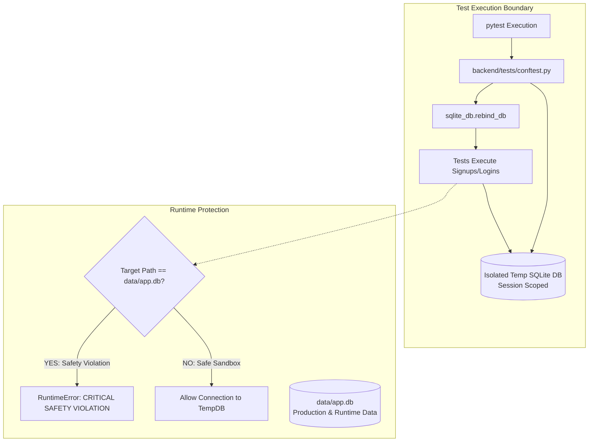
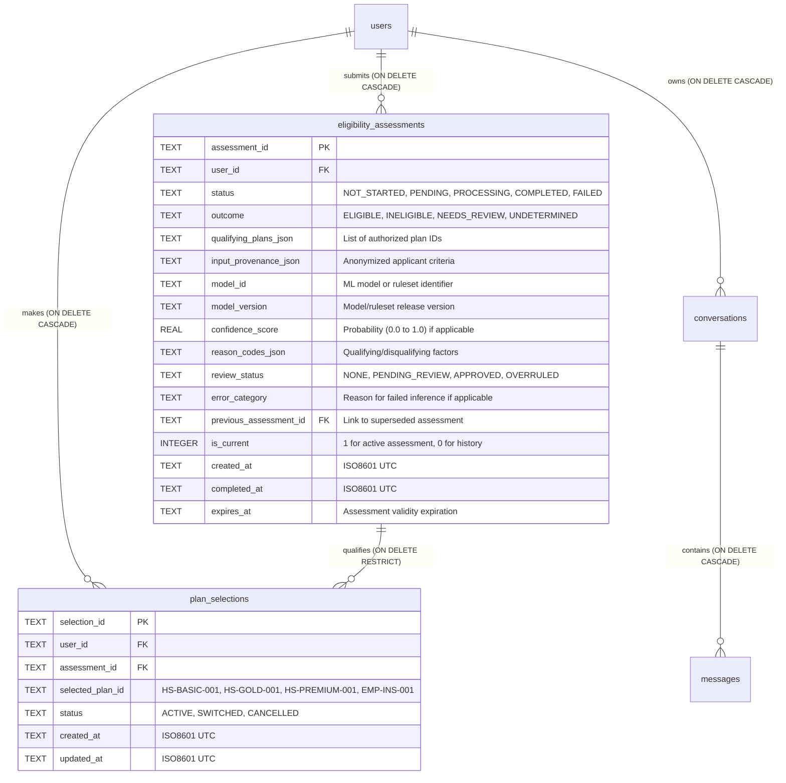

# Implementation-Readiness Architecture: Database, Eligibility Analytics & Pipeline Foundation

**Project:** AI Insurance Assistant  
**Repository:** `Capstone_rag`  
**Milestone:** Phase 3 Architecture & Database Preparation  
**Target Customer Workflow:** `Sign In → Eligibility Assessment (ML) → Choose Plan → Policy Chat → Plan Preparation`  
**Status:** Pre-Implementation Architectural Blueprint & Test Isolation Deliverable  
**Date:** October 25, 2026  

---

## 1. Executive Status & Safety Compliance

As instructed, this phase establishes the **database foundation, test isolation, analytics formulas, schema specifications, and dashboard architecture** required before introducing the machine learning eligibility model.

### Key Pre-Implementation Actions Completed:
1. **Database Safety Backup Created & Verified:**
   - Full point-in-time snapshot created at: [`data/backups/app_pre_cleanup_backup_20261025_142925.db`](file:///c:/Users/shivu/OneDrive/Desktop/Capstone_rag/data/backups/app_pre_cleanup_backup_20261025_142925.db) (544,768 bytes).
   - Validated via `PRAGMA integrity_check;` (`ok`) with 100% row match across all 9 tables.
2. **Automated Test Isolation Implemented & Verified:**
   - Created [`backend/tests/conftest.py`](file:///c:/Users/shivu/OneDrive/Desktop/Capstone_rag/backend/tests/conftest.py) providing automatic session-level test database isolation (`test_app.db` in a temporary sandbox).
   - Implemented an active fail-safe in [`backend/app/db/sqlite_manager.py`](file:///c:/Users/shivu/OneDrive/Desktop/Capstone_rag/backend/app/db/sqlite_manager.py): If any test attempts to query or write to `data/app.db`, `RuntimeError("CRITICAL SAFETY VIOLATION")` is immediately thrown.
   - Added regression test suite [`backend/tests/test_database_isolation.py`](file:///c:/Users/shivu/OneDrive/Desktop/Capstone_rag/backend/tests/test_database_isolation.py) (3/3 passing).
   - Re-ran [`test_auth_and_session.py`](file:///c:/Users/shivu/OneDrive/Desktop/Capstone_rag/backend/tests/test_auth_and_session.py) (12/12 passing). Verified that runtime `data/app.db` user count remained exactly **196** (zero test pollution).
3. **Dry-Run Cleanup Plan Formulated:**
   - Detailed mapping of the 191 test accounts and their cascading dependencies ready for review.
   - **No records deleted.** All data changes paused awaiting explicit user authorization.

---

## 2. Verified Current Database Schema & Inventory

The runtime application operates against SQLite database `data/app.db` (`WAL` journal mode, `foreign_keys = ON`).

### Table Inventory & Record Counts

| Table Name | Record Count | Primary Key | Foreign Key Constraints | Role / Content |
|---|:---:|---|---|---|
| `users` | **196** | `user_id` | *None* (Unique on `email COLLATE NOCASE`) | Credentials, bcrypt password hashes, roles, approval status |
| `sessions` | **346** | `token` | `FOREIGN KEY (user_id) REFERENCES users(user_id) ON DELETE CASCADE` | 24-hour bearer tokens (227 active, 119 expired) |
| `profiles` | **196** | `user_id` | `FOREIGN KEY (user_id) REFERENCES users(user_id) ON DELETE CASCADE` | 1:1 user profile, governance status, last login |
| `conversations` | **53** | `conversation_id` | *Missing DB FK to users* (Application enforced) | Plan-scoped conversation headers (24 active, 29 test) |
| `messages` | **54** | `message_id` | `FOREIGN KEY (conversation_id) REFERENCES conversations(conversation_id) ON DELETE CASCADE` | Multi-turn user queries & assistant answers with citations |
| `document_records` | **4** | `document_id` | *None* | Registry of 4 policy PDFs (`HS-BASIC`, `HS-GOLD`, `HS-PREMIUM`, `EMP-INS`) |
| `ingestion_jobs` | **4** | `job_id` | `FOREIGN KEY (document_id) REFERENCES document_records(document_id) ON DELETE SET NULL` | Audit logs of document parsing and chunk indexing |
| `rag_request_metrics` | **24** | `metric_id` | *Missing DB FK to users* | Latency benchmarks, retrieved chunks, citations count |
| `audit_logs` | **238** | `event_id` | *Missing DB FK to users* | Security audit trail (logins, 403 blocks, doc changes) |

---

## 3. Verified Account Breakdown & Dry-Run Cleanup Plan

### A. Origin of the 196 Accounts

$$\text{Total Users in Database} = 3 \text{ (Seed Accounts)} + 191 \text{ (Pytest Injections)} + 2 \text{ (Manual Human Signups)} = \mathbf{196}$$

1. **Default System Seeds (3 accounts):**
   - `admin@insurance.corp` (Enterprise Compliance Administrator)
   - `employee@insurance.corp` (Authorized Employee Staff)
   - `customer@insurance.com` (Policy Holder Customer)
2. **Pytest Injections from Past Test Runs (191 accounts):**
   - `test_user_<hex>@example.com`: 32 accounts
   - `dup_user_<hex>@example.com`: 32 accounts
   - `applicant_<hex>@gmail.com`: 32 accounts
   - `staff_<hex>@insurance.corp`: 31 accounts
   - `login_test_<hex>@example.com`: 32 accounts
   - `honest_customer_<hex>@example.com`: 32 accounts
3. **Authentic Human Signups (2 accounts):**
   - `usr_d9cfdc60a323` (`abc@gmail.com`, created 2026-10-23 18:18 UTC)
   - `usr_5f7135ba5aa2` (`abcd@gmail.com`, created 2026-10-23 18:21 UTC)

### B. Dry-Run Remediation Impact Analysis
A dry-run analysis was executed via `scratch/dry_run_cleanup.py`. If approved, the cleanup will produce the following exact results:

| Entity / Table | Current Count | Target Pruned | Retained Count | Retained Details / Justification |
|---|:---:|:---:|:---:|---|
| `users` | 196 | **191** | **5** | 3 Verified Seeds (`admin`, `employee`, `customer`) + 2 Human Signups |
| `profiles` | 196 | **191** | **5** | 1:1 match with retained users (via `ON DELETE CASCADE`) |
| `sessions` | 346 | **223** | **123** | 123 authentic admin/employee/customer login tokens retained |
| `conversations` | 53 | **29** | **24** | 24 genuine demo/customer chats retained; 29 `'test_user'` chats pruned |
| `messages` | 54 | **40** | **14** | 14 genuine conversation turns retained; 40 `'test_user'` turns pruned |
| `rag_request_metrics`| 24 | **17** | **7** | 7 genuine RAG telemetry rows retained; 17 test rows pruned |
| `audit_logs` | 238 | **0** | **238** | Retained in full to preserve immutable historical security audit trail |
| `document_records` | 4 | **0** | **4** | Completely unaffected (Knowledge base unchanged) |
| `ingestion_jobs` | 4 | **0** | **4** | Completely unaffected |

*Status: Awaiting user approval before applying any delete operations.*

---

## 4. Test Isolation Architecture (Implemented & Verified)

To ensure that automated tests never again pollute `data/app.db`, a two-layered defense was implemented:



### Verification Evidence:
- **Test File:** [`backend/tests/test_database_isolation.py`](file:///c:/Users/shivu/OneDrive/Desktop/Capstone_rag/backend/tests/test_database_isolation.py)
- **Test 1:** `test_database_is_isolated_from_runtime` $\rightarrow$ **PASSED**
- **Test 2:** `test_runtime_database_access_fails_safely_during_tests` $\rightarrow$ **PASSED**
- **Test 3:** `test_test_record_creation_does_not_pollute_runtime_database` $\rightarrow$ **PASSED**
- **Suite Execution:** Ran full 12 tests in `test_auth_and_session.py` $\rightarrow$ Runtime user count remained unchanged at 196.

---

## 5. Proposed Eligibility & Plan Selection Data Model

To support the target workflow (`Sign In → Eligibility Assessment → Choose Plan → Policy Chat → Plan Preparation`), we propose adding two normalized tables and adding missing foreign key constraints:



### Table 1: `eligibility_assessments`
- `assessment_id` (TEXT PRIMARY KEY): `asmt_<uuid>`.
- `user_id` (TEXT NOT NULL, `FOREIGN KEY REFERENCES users(user_id) ON DELETE CASCADE`).
- `status` (TEXT NOT NULL): Processing lifecycle:
  - `NOT_STARTED`: Assessment initiated but inputs pending.
  - `PENDING`: Queued for evaluation.
  - `PROCESSING`: Inference/underwriting execution underway.
  - `COMPLETED`: Assessment completed and outcome rendered.
  - `FAILED`: Execution/inference failed (e.g., timeout, malformed input).
- `outcome` (TEXT NOT NULL): Underwriting outcome:
  - `ELIGIBLE`: Applicant satisfies qualifying criteria for one or more plans.
  - `INELIGIBLE`: Applicant does not meet criteria.
  - `NEEDS_REVIEW`: Ambiguous/borderline score requiring manual insurer underwriting.
  - `UNDETERMINED`: Assessment could not establish outcome (e.g. system failure).
- `qualifying_plans_json` (TEXT DEFAULT `'[]'`): JSON list of plan IDs the user qualifies for (e.g. `["HS-BASIC-001", "HS-GOLD-001"]`).
- `input_provenance_json` (TEXT DEFAULT `'{}'`): Sanitized applicant profile payload (e.g. age bracket, tobacco use, pre-existing condition flags). No unneeded PII.
- `model_id` (TEXT): Underwriting model/engine ID (e.g. `underwriting_xgb_v1` or `ruleset_underwrite_v1`).
- `model_version` (TEXT): Version tracking (e.g. `1.0.0`).
- `confidence_score` (REAL NULLABLE): Calibrated model probability or qualification score.
- `reason_codes_json` (TEXT DEFAULT `'[]'`): Structured justification codes (e.g. `["QUALIFIED_AGE_BAND", "FLAG_PREEXISTING_CONDITION"]`).
- `review_status` (TEXT DEFAULT `'NONE'`): Manual underwriter review status (`NONE`, `PENDING_REVIEW`, `APPROVED`, `OVERRULED`).
- `error_category` (TEXT NULLABLE): Failure reason (`MODEL_TIMEOUT`, `INVALID_SCHEMA`, `SERVICE_UNAVAILABLE`).
- `previous_assessment_id` (TEXT NULLABLE, `FK -> eligibility_assessments(assessment_id) ON DELETE SET NULL`): Reassessment linkage.
- `is_current` (INTEGER NOT NULL DEFAULT 1): High-speed query flag for the user's latest valid assessment.
- `created_at` (TEXT NOT NULL): ISO8601 UTC.
- `completed_at` (TEXT NULLABLE): ISO8601 UTC.
- `expires_at` (TEXT NULLABLE): Assessment expiration (e.g., valid for 30 days).
- **Indexes:**
  - `idx_asmt_user_current` ON `(user_id, is_current)`
  - `idx_asmt_outcome` ON `(outcome)`
  - `idx_asmt_status` ON `(status)`
  - `idx_asmt_completed` ON `(completed_at)`

### Table 2: `plan_selections`
- `selection_id` (TEXT PRIMARY KEY): `psel_<uuid>`.
- `user_id` (TEXT NOT NULL, `FOREIGN KEY REFERENCES users(user_id) ON DELETE CASCADE`).
- `assessment_id` (TEXT NOT NULL, `FOREIGN KEY REFERENCES eligibility_assessments(assessment_id) ON DELETE RESTRICT`): Guaranteeing that a plan selection can **never** be created without a valid qualifying assessment.
- `selected_plan_id` (TEXT NOT NULL): The chosen plan ID from the plan registry.
- `status` (TEXT NOT NULL DEFAULT `'ACTIVE'`): `'ACTIVE'`, `'SWITCHED'`, `'CANCELLED'`.
- `created_at` (TEXT NOT NULL): ISO8601 UTC.
- `updated_at` (TEXT NOT NULL): ISO8601 UTC.
- **Indexes:**
  - `idx_psel_user_status` ON `(user_id, status)`

### Handling Assessment History & Reassessments
When a user updates inputs or requests reassessment:
1. An atomic transaction sets `is_current = 0` on their existing active assessment.
2. A new row is inserted with `is_current = 1`, recording `previous_assessment_id = <old_id>`.
3. If the outcome changes from `ELIGIBLE` to `INELIGIBLE`, any downstream active `plan_selections` are updated to `status = 'CANCELLED'` with an audit log.

---

## 6. Accurate Pipeline Analytics & Calculation Formulas

Every dashboard metric is defined below with its exact SQL calculation against real persisted tables. No hardcoded or synthetic values will be permitted.

### A. Executive Overview KPIs

| Metric | Business Definition | Exact SQL Calculation |
|---|---|---|
| **Registered Users** | Distinct registered user accounts | `SELECT COUNT(*) FROM users;` |
| **Users Assessed** | Unique users with at least one completed assessment | `SELECT COUNT(DISTINCT user_id) FROM eligibility_assessments WHERE status = 'COMPLETED';` |
| **Eligible Users** | Unique users whose current active assessment outcome is ELIGIBLE and not expired | `SELECT COUNT(DISTINCT user_id) FROM eligibility_assessments WHERE is_current = 1 AND status = 'COMPLETED' AND outcome = 'ELIGIBLE' AND (expires_at IS NULL OR expires_at > datetime('now'));` |
| **Ineligible Users** | Unique users whose current active assessment outcome is INELIGIBLE | `SELECT COUNT(DISTINCT user_id) FROM eligibility_assessments WHERE is_current = 1 AND status = 'COMPLETED' AND outcome = 'INELIGIBLE';` |
| **Pending Review** | Unique users whose current assessment requires underwriter human review | `SELECT COUNT(DISTINCT user_id) FROM eligibility_assessments WHERE is_current = 1 AND outcome = 'NEEDS_REVIEW';` |
| **Not Assessed** | Registered users who have never completed an eligibility assessment | `SELECT COUNT(*) FROM users WHERE user_id NOT IN (SELECT DISTINCT user_id FROM eligibility_assessments WHERE status = 'COMPLETED');` |
| **Plan Selected** | Unique users who have an active plan selection | `SELECT COUNT(DISTINCT user_id) FROM plan_selections WHERE status = 'ACTIVE';` |
| **Active Chat** | Unique users with active plan selections who have sent at least one chat message | `SELECT COUNT(DISTINCT c.user_id) FROM conversations c JOIN messages m ON c.conversation_id = m.conversation_id WHERE c.user_id IN (SELECT DISTINCT user_id FROM plan_selections WHERE status = 'ACTIVE');` |
| **Failed Pipeline Jobs** | Failed assessment inferences + failed document ingestion jobs | `SELECT (SELECT COUNT(*) FROM eligibility_assessments WHERE status = 'FAILED') + (SELECT COUNT(*) FROM ingestion_jobs WHERE status = 'FAILED');` |

### B. Funnel Progression & Conversion Metrics
All conversion percentages enforce `denominator > 0` checks:

$$\text{Assessment Completion Rate} = \frac{\text{Users Assessed}}{\text{Registered Users}} \times 100$$

$$\text{Eligibility Approval Rate} = \frac{\text{Eligible Users}}{\text{Users Assessed}} \times 100$$

$$\text{Plan Selection Rate} = \frac{\text{Users with Active Plan Selection}}{\text{Eligible Users}} \times 100$$

$$\text{Policy Chat Engagement Rate} = \frac{\text{Users Who Initiated Policy Chat}}{\text{Users with Active Plan Selection}} \times 100$$

$$\text{Plan Preparation Completion Rate} = \frac{\text{Users Completed Plan Preparation}}{\text{Users Who Initiated Policy Chat}} \times 100$$

---

## 7. Simplified Administrator Dashboard Specification

The existing dashboard tables (`AdminDashboardPage.jsx`) currently display raw user IDs and comma-separated policy scopes (`HS-BASIC-001, HS-GOLD-001, HS-PREMIUM-001...`). 

The redesign simplifies this into a clean, modern layout adhering to the existing **Liquid Glass design system**:

### A. Executive Overview Tab
- **Row 1 — Topline KPI Tiles (8 Frosted Cards):**
  1. `Registered Users`
  2. `Eligible Users` (Green badge)
  3. `Ineligible Users` (Neutral/Gray badge)
  4. `Pending Review` (Amber badge)
  5. `Not Assessed` (Blue badge)
  6. `Plan Selected` (Purple badge)
  7. `Policy Chat Active` (Cyan badge)
  8. `Pipeline Errors / Failed` (Rose badge)
- **Row 2 — Workflow Funnel & Telemetry:**
  - **Left Card (60% width):** Horizontal Step Funnel visualizing `Registered (100%) → Assessed → Eligible → Plan Selected → Policy Chat → Prepared`, with drop-off percentages between stages.
  - **Right Card (40% width):** Consultation Distribution by Plan (`HS-BASIC-001`, `HS-GOLD-001`, `HS-PREMIUM-001`, `EMP-INS-001`).
- **Row 3 — Live Activity Stream:** Real-time filterable operational event log (with filters for `ALL`, `SUCCESS`, `FORBIDDEN / BLOCKED`, `ERROR`).

### B. Users & Customers Tab
- **Default Table Columns:**
  1. **User:** Full name and email address. (Raw internal `user_id` hidden from main table).
  2. **Role:** Clean pill badge (`Customer`, `Employee`, `Admin`).
  3. **Account Status:** Active / Pending toggle.
  4. **Eligibility:** Status pill badge:
     - `Eligible` (Green)
     - `Ineligible` (Red/Gray)
     - `Needs Review` (Amber)
     - `Not Assessed` (Subtle muted gray)
  5. **Selected Plan:** Name of active chosen plan (e.g. `Health Shield - Gold`), or `None Selected`.
  6. **Joined:** Relative or clean short date (`Oct 23, 2026`).
  7. **Actions:** Action buttons: `View Details` and `Status Toggle`.
- **User Detail Modal / Side Drawer (Liquid Glass):**
  - Displays full UUID `user_id`.
  - Authorized plan scopes list.
  - Full Eligibility Assessment history (timestamps, score, reason codes, model version).
  - Active conversation links.

### C. Audit Log Tab
- Columns: `Timestamp` | `Action` | `Actor Email` | `Actor Role` | `Resource` | `Outcome` | `Details`
- Preserves genuine `403 FORBIDDEN` security blocks for administrative compliance audit trails.
- Filters: Date range picker (`24h`, `7d`, `30d`, `custom`), Outcome filter, Actor role filter.

---

## 8. Backend Endpoints Required for Eligibility Architecture

To support the target workflow, the following backend endpoints will be added:

1. **`POST /api/eligibility/assess`**
   - **Auth:** Authenticated user (`customer` or `employee`).
   - **Payload:** User input criteria (e.g. age, tobacco status, coverage requirements).
   - **Logic:** Validates input schema $\rightarrow$ executes underwriting engine $\rightarrow$ records assessment row in `eligibility_assessments` with `is_current = 1` $\rightarrow$ returns assessment result and qualifying plan IDs.
2. **`GET /api/eligibility/me`**
   - **Auth:** Current authenticated user.
   - **Logic:** Queries current assessment for user (`is_current = 1`). Returns outcome and qualified plans, or `{status: "NOT_STARTED"}` if unassessed.
3. **`POST /api/plans/select`**
   - **Auth:** Current authenticated user.
   - **Payload:** `{selected_plan_id, assessment_id}`.
   - **Logic:** Verifies that `assessment_id` belongs to user, is active, is `ELIGIBLE`, and includes `selected_plan_id` in `qualifying_plans_json`. Writes record to `plan_selections`.
4. **`GET /api/admin/eligibility/metrics`**
   - **Auth:** Server-side administrator (`admin` role required).
   - **Logic:** Executes the exact SQL queries in Section 6, returning overview counts, funnel metrics, and pipeline health for the requested date window.
5. **`GET /api/admin/eligibility/reviews`**
   - **Auth:** Administrator.
   - **Logic:** Returns paginated assessments where `outcome = 'NEEDS_REVIEW'`.
6. **`PATCH /api/admin/eligibility/reviews/{assessment_id}`**
   - **Auth:** Administrator.
   - **Payload:** `{decision: "APPROVED" | "OVERRULED", notes: str}`.
   - **Logic:** Updates assessment outcome with underwriter override and records an immutable audit log.

---

## 9. Security, RBAC & Protection Controls

1. **Server-Side Enforcement:** Frontend state cannot grant eligibility or bypass plan restrictions. Every request to `POST /api/conversations` will verify `plan_selections` in the database.
2. **Customer Data Isolation:** Customers can query only their own assessments and plan selections (`WHERE user_id = current_user.user_id`).
3. **Admin Privilege Verification:** Administrator endpoints depend on `get_admin_user` ([backend/app/api/deps.py](file:///c:/Users/shivu/OneDrive/Desktop/Capstone_rag/backend/app/api/deps.py)), validating user role against the database session token.
4. **Audit Trail:** Every manual eligibility override, user status toggle, and plan change generates an audit record in `audit_logs`.
5. **PII Minimization:** Applicant inputs are stored in `input_provenance_json` using categorical ranges (e.g., `age_band: "30-39"`) rather than raw identifying personal data.

---

## 10. Database Migration & Rollback Strategy

### A. Forward Migration Plan
1. **Pre-Migration Safety Backup:** Always execute a full backup prior to migration.
2. **Schema Upgrade Script:** Execute SQLite transaction:
   ```sql
   BEGIN TRANSACTION;
   
   -- 1. Create eligibility_assessments table
   CREATE TABLE IF NOT EXISTS eligibility_assessments (
       assessment_id TEXT PRIMARY KEY,
       user_id TEXT NOT NULL,
       status TEXT NOT NULL,
       outcome TEXT NOT NULL,
       qualifying_plans_json TEXT DEFAULT '[]',
       input_provenance_json TEXT DEFAULT '{}',
       model_id TEXT,
       model_version TEXT,
       confidence_score REAL,
       reason_codes_json TEXT DEFAULT '[]',
       review_status TEXT DEFAULT 'NONE',
       error_category TEXT,
       previous_assessment_id TEXT,
       is_current INTEGER NOT NULL DEFAULT 1,
       created_at TEXT NOT NULL,
       completed_at TEXT,
       expires_at TEXT,
       FOREIGN KEY (user_id) REFERENCES users(user_id) ON DELETE CASCADE,
       FOREIGN KEY (previous_assessment_id) REFERENCES eligibility_assessments(assessment_id) ON DELETE SET NULL
   );

   -- 2. Create plan_selections table
   CREATE TABLE IF NOT EXISTS plan_selections (
       selection_id TEXT PRIMARY KEY,
       user_id TEXT NOT NULL,
       assessment_id TEXT NOT NULL,
       selected_plan_id TEXT NOT NULL,
       status TEXT NOT NULL DEFAULT 'ACTIVE',
       created_at TEXT NOT NULL,
       updated_at TEXT NOT NULL,
       FOREIGN KEY (user_id) REFERENCES users(user_id) ON DELETE CASCADE,
       FOREIGN KEY (assessment_id) REFERENCES eligibility_assessments(assessment_id) ON DELETE RESTRICT
   );

   -- 3. Create high-performance indexes
   CREATE INDEX IF NOT EXISTS idx_asmt_user_current ON eligibility_assessments(user_id, is_current);
   CREATE INDEX IF NOT EXISTS idx_asmt_outcome ON eligibility_assessments(outcome);
   CREATE INDEX IF NOT EXISTS idx_asmt_status ON eligibility_assessments(status);
   CREATE INDEX IF NOT EXISTS idx_asmt_completed ON eligibility_assessments(completed_at);
   CREATE INDEX IF NOT EXISTS idx_psel_user_status ON plan_selections(user_id, status);

   COMMIT;
   ```
3. **Foreign Key Integrity Backfill:** For existing legacy conversations lacking physical FK constraints, migrate them to an upgraded `conversations` table enforcing `FOREIGN KEY (user_id) REFERENCES users(user_id) ON DELETE CASCADE`.

### B. Rollback Procedure
If any step fails:
1. `ROLLBACK;` terminates any open transaction.
2. If post-migration issues occur, restore from backup:
   `sqlite3 data/app.db ".restore 'data/backups/app_pre_cleanup_backup_<timestamp>.db'"`

---

## 11. Machine Learning Model & Training Data Requirements

To prepare for Phase 3 (ML Model Implementation), the following engineering specifications are required before any model training:

1. **Problem Formulation:** Multi-class or multi-label classification predicting plan tier qualification (`HS-BASIC`, `HS-GOLD`, `HS-PREMIUM`) or binary risk acceptance.
2. **Input Feature Space:**
   - Demographic: Age (normalized), Gender (categorical).
   - Health Factors: BMI (float), Tobacco use (binary 0/1), Chronic condition count (integer), Hospitalization history past 3 years (binary).
   - Financial/Coverage: Desired sum insured, Deductible preference tier.
3. **Training Data Requirements:**
   - Must use an authentic or calibrated underwriting dataset (e.g. synthetic actuarial health dataset or anonymized underwriting records).
   - Training pipeline must log calibration curves, ROC-AUC, Precision-Recall per plan tier, and demographic parity/fairness metrics.
4. **Inference Pipeline & Artifacts:**
   - Export model as versioned ONNX or serialized scikit-learn/XGBoost artifact in `backend/app/models/eligibility/`.
   - Feature preprocessor pipeline bundled with model version tag.

---

## 12. Decisions Required Before Implementation

The following 4 decisions are submitted for your review and approval:

1. **Data Cleanup Approval:** Do you approve running the cleanup script to remove the 191 automated test accounts and their associated sessions, leaving the 3 verified seed accounts and 2 human accounts?
2. **Eligibility Engine Type:** Should Phase 3 implement:
   - **Option A:** A deterministic business rules engine first (100% transparent, rule-based), followed by ML scoring?
   - **Option B:** A direct machine learning classification model (e.g. XGBoost/Random Forest)?
3. **Applicant Input Form:** Which specific questions/features should be asked on the customer's Eligibility Assessment screen?
4. **Plan Selection Gating:** Do you approve enforcing a hard backend block so that users cannot open a Policy Chat conversation on a plan unless they possess an active `ELIGIBLE` assessment?

---

*This document marks the conclusion of the database preparation and test isolation phase. No runtime data has been modified. We await your approval on the above decisions before proceeding with data cleanup and ML pipeline implementation.*
