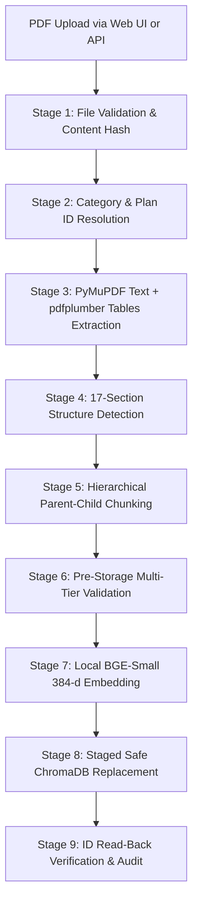

# Ingestion Pipeline Specification & Operational Guide (9 Stages)

**Status:** Verified & Persistent in Chroma Cloud  
**Total Corpus:** 119 Child Chunks | 68 Parent Sections (17 sections per plan)  
**Last Updated:** October 2026  

---

## 1. Supported Plan Specifications

The ingestion pipeline handles 4 distinct insurance plans across 2 primary operational categories:

| Plan ID | Policy Name | Audience Category | Source File | Chunks Stored | Parent Sections |
|---|---|---|---|---|---|
| **HS-BASIC-001** | Health Shield – Basic | Customer | `health_shield_basic.pdf` | **32** | **17** |
| **HS-GOLD-001** | Health Shield – Gold | Customer | `health_shield_gold.pdf` | **30** | **17** |
| **HS-PREMIUM-001** | Health Shield – Premium | Customer | `health_shield_premium.pdf` | **29** | **17** |
| **EMP-INS-001** | Executive Employee Insurance Plan | Employee Only | `executive_employee_insurance_plan.pdf` | **28** | **17** |
| **Total** | — | — | — | **119** | **68** |

---

## 2. The 9-Stage Execution Lifecycle

### Stage 1: File Validation & Content Hash
- **Magic Byte Check:** Validates `%PDF-` file header signatures and enforces a 25 MB file limit.
- **SHA-256 Hash Deduplication:** Computes the document hash.
- **Dynamic Re-Ingestion Guarantee:** Before marking a file as `SKIPPED_DUPLICATE`, the system queries Chroma Cloud to ensure records for this document actually exist in storage. If the vector store was cleared, it seamlessly proceeds with re-ingestion.

### Stage 2: Category & Plan Identity Resolution
- Supports the two primary UI upload categories:
  1. **Customer Insurance:** Inspects pages 1–3 for specific policy titles. Differentiates **Basic**, **Gold**, and **Premium** without confusion from section titles.
  2. **Employee Insurance:** Binds strictly to `EMP-INS-001` and marks `data_status: illustrative_unverified` and `access_level: employee`.

### Stage 3: Hybrid Document Extraction
- **Text & Reading Order:** PyMuPDF (`fitz`) extracts clean text streams, coordinate layouts, and physical page numbers.
- **Tabular Grids:** `pdfplumber` isolates table structures, parsing headers, rows, and multi-page continuation into structured markdown tables.
- **OCR Fallback Check:** Evaluates character density (< 50 chars per page with raster images triggers OCR).

### Stage 4: 17-Section Structure Detection
- Strictly matches sequential section headers using regex `^SECTION\s+(\d+)` to avoid false positives on subsection bullet items (e.g. `1. Dengue`).
- Extracts exactly 17 sections per policy document:
  - Section 1: Preamble & Definitions
  - Section 2: Premium & Payment Terms
  - Section 3: Hospital Cash Benefit Schedule
  - Section 4: Day-Care & Surgical Benefit Tables
  - Section 5: Waiting Periods & Pre-Existing Conditions
  - Section 6: Annual Claim-Free Benefit Increase Rules
  - Sections 7–17: Exclusions, Claims, Grievances, General Terms, and Schedules.

### Stage 5: Hierarchical Parent-Child Chunking
- **Durable Parent Records:** Each complete section is stored in `parent_store.json` under `{PLAN_ID}-SEC-{NUM}` with complete text, markdown tables, and page spans.
- **Child Chunks:** Targeted at 450–550 tokens. Continuous narrative prose receives a 60–100 token overlap.
- **Table Integrity:** Surgical procedures, cash schedules, and benefit matrices are kept intact without arbitrary row-level truncation.

### Stage 6: Pre-Storage Multi-Tier Validation
- Verifies that all child chunks are linked to valid parent IDs (`parent_section_id`).
- Enforces strict flat primitive metadata schema required by ChromaDB (`str`, `int`, `float`, `bool`).
- Validates that text content is non-empty and contains valid printable characters.

### Stage 7: Local Dense Embedding Generation
- Encodes all child texts using local `BAAI/bge-small-en-v1.5` running on CPU or GPU.
- Generates normalized 384-dimensional dense vectors with zero external API latency or cost.
- Validates vector non-zeroness and finite float values.

### Stage 8: Staged Safe ChromaDB Replacement
- Queries ChromaDB collection `insurance_knowledge` for existing records matching `source_document`.
- Upserts newly validated chunks and deletes obsolete chunk IDs in a safe atomic stage.
- Never wipes or overwrites unrelated plans in the collection.
- Serializes full parent models to [parent_store.json](file:///c:/Users/shivu/OneDrive/Desktop/Capstone_rag/data/staging/parent_store.json).

### Stage 9: ID Read-Back Verification & Audit
- Performs immediate read-back query to ChromaDB by chunk IDs to verify persistence.
- Updates persistent audit history in [ingestion_history.json](file:///c:/Users/shivu/OneDrive/Desktop/Capstone_rag/data/staging/ingestion_history.json).
- Returns comprehensive execution summary (pages, sections, tables, calculations, chunks, vectors).
