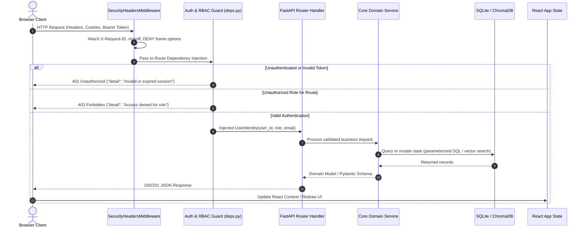
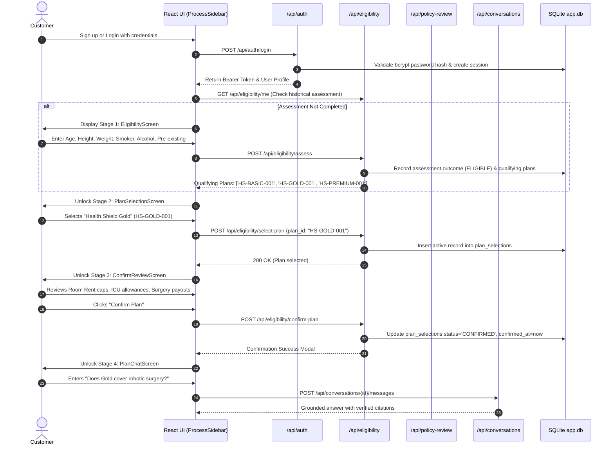
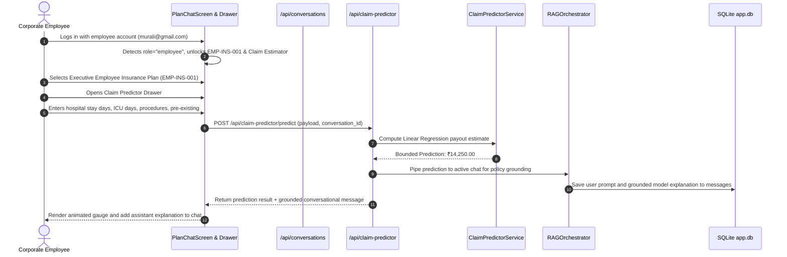
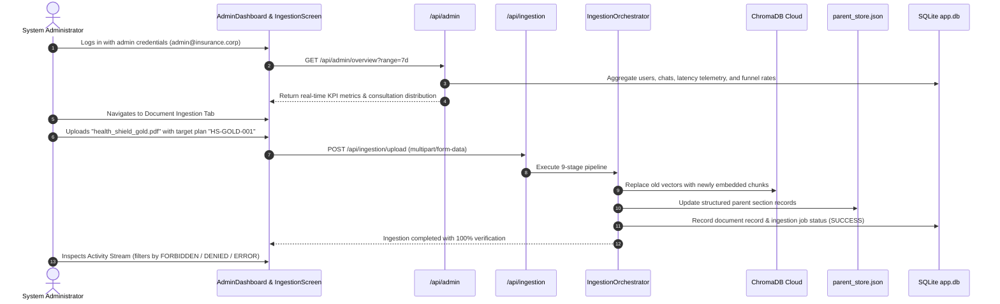
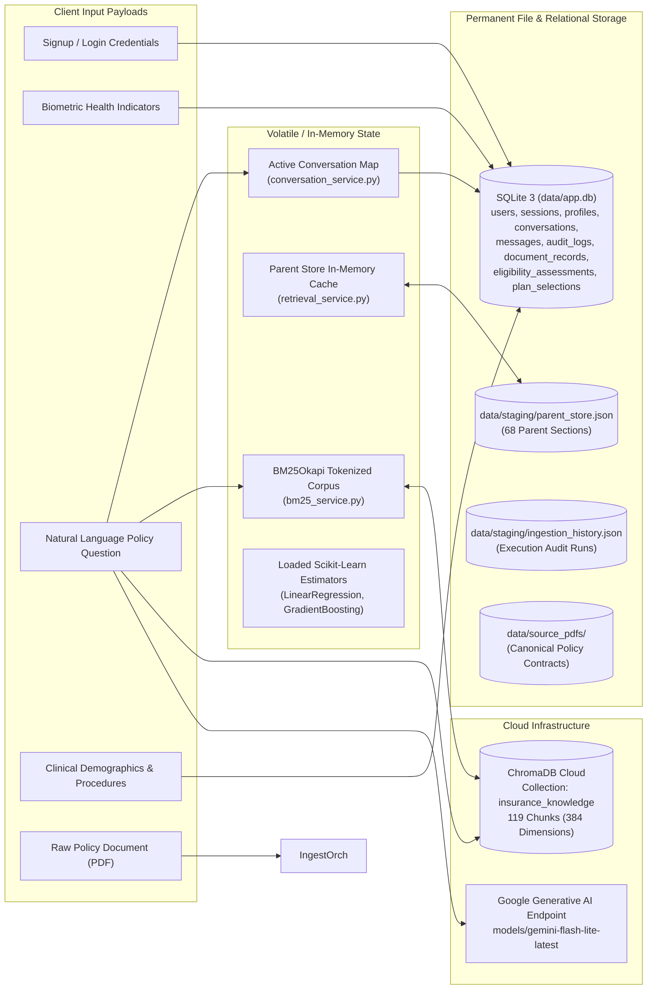

# System Architecture, Component Design, and End-to-End Data Flows
## AI Health Insurance Assistant Platform

**Document Reference:** `docs/PROJECT_ARCHITECTURE_AND_DATA_FLOWS.md`  
**Associated Deliverable:** Master Knowledge Bible Companion Document 1  
**Project:** AI Health Insurance Assistant (Plan-Scoped RAG, ML Underwriting, Claim Prediction & Ingestion Platform)  
**Corpus / Repository:** `shivakumarbhandari2003/Capstone-project`  
**Target Audience:** Students, Software Architects, Viva Examiners, and Technical Interviewers  

---

## 1. System Overview and Layered Architecture

The **AI Health Insurance Assistant** is an enterprise-grade, multi-tenant, plan-scoped AI platform designed to automate health insurance consultation, underwriting eligibility scoring, predictive claim estimation, and policy document management.

The platform is designed around a **4-tier decoupled architecture**:
1. **Presentation Tier (Frontend SPA):** Built with React 19 and Vite using pure JavaScript (JSX) and Vanilla CSS. It provides responsive interfaces for plan selection, interactive chat with animated thinking indicators, a Claim Predictor drawer, underwriting eligibility modals, and an Admin governance portal.
2. **Application Gateway Tier (FastAPI Backend):** High-performance Python ASGI backend handling JWT session authentication, server-enforced Role-Based Access Control (RBAC), request sanitization, routing, and global exception handling.
3. **Core Intelligence and Domain Services Tier:**
   - **Hybrid RAG Engine:** Combines dense semantic vector retrieval (ChromaDB Cloud) with sparse lexical retrieval (Rank-BM25), fused via Reciprocal Rank Fusion ($k=60$) and expanded through a hierarchical parent-document store (`parent_store.json`).
   - **Answer Generation Service:** Interfaces with Google Gemini API (`gemini-flash-lite-latest` and `gemini-flash-latest`) and features an offline, deterministic Grounded Extractive Synthesizer fallback.
   - **Machine Learning Services:** Thread-safe singleton inference engines for Linear Regression claim estimation (`insurance_claim_model.pkl`) and Gradient Boosting underwriting classification (`eligibility_model.pkl`).
   - **Deterministic Policy Review Service:** Computes exact room rent limits, ICU daily allowances, ambulance reimbursement, and surgical category benefits directly from canonical policy rules.
4. **Data Persistence and Vector Storage Tier:**
   - **SQLite Database (`data/app.db`):** 12 normalized tables running in Write-Ahead Logging (WAL) mode with 15 secondary indexes.
   - **ChromaDB Cloud:** Remote vector database hosting 384-dimensional dense embeddings (`BAAI/bge-small-en-v1.5`) across 119 child chunks.
   - **Staging File Registries:** Durable JSON registries for parent section markdown (`parent_store.json`), ingestion run audits (`ingestion_history.json`), and conversation snapshots.

---

## 2. Complete End-to-End Architecture Diagram

```mermaid
flowchart TB
    subgraph ClientLayer ["1. Presentation Layer (React 19 + Vite)"]
        UI_Auth["Auth Gateway<br/>(LoginScreen, SignupScreen)"]
        UI_Nav["Session Bar & Process Sidebar<br/>(Role Indicators & Stage Stepper)"]
        UI_Elig["Eligibility Assessment Screen<br/>(Biometric Inputs & Risk Gauge)"]
        UI_PlanSel["Plan Selection Screen<br/>(Basic, Gold, Premium, Corporate Cards)"]
        UI_Confirm["Confirm & Review Screen<br/>(Liquid Glass Policy Term Breakdown)"]
        UI_Chat["Plan-Scoped Chat Workspace<br/>(Thinking Orb, Citation Drawer, Voice Input)"]
        UI_ClaimDrawer["Claim Predictor Drawer<br/>(10 Demographics Inputs & Gauge)"]
        UI_Admin["Admin Governance Workspace<br/>(KPI Cards, Ingestion Screen, User Manager)"]
    end

    subgraph GatewayLayer ["2. Application Gateway (FastAPI 0.115)"]
        SecHeaders["SecurityHeadersMiddleware<br/>(X-Frame-Options: DENY, CSP, X-Request-ID)"]
        CORS["CORSMiddleware<br/>(Strict Origin Whitelist: 5173, 3000)"]
        AuthRouter["/api/auth<br/>(signup, login, logout, me)"]
        EligRouter["/api/eligibility<br/>(assess, me, select-plan, confirm-plan, agent-contact)"]
        PlansRouter["/api/plans<br/>(Plan Catalog Filtered by Role)"]
        ConvoRouter["/api/conversations<br/>(Conversation & Message CRUD)"]
        ClaimRouter["/api/claim-predictor<br/>(Employee-Only Predict & Explain)"]
        AdminRouter["/api/admin<br/>(Overview KPIs, Activity Stream, Users)"]
        IngestRouter["/api/ingestion & /api/upload<br/>(PDF Upload, Run Pipeline, Status)"]
    end

    subgraph SecurityLayer ["3. Security, Guardrails & Authorization"]
        AuthSvc["AuthorizationService (auth_service.py)<br/>(Bcrypt Hashing, Session Verification, RBAC)"]
        InputGuard["InputGuardrail (guardrails.py)<br/>(NFC Normalization, Bidi Strip, Injection Screen)"]
        ScopeRes["ScopeResolver (scope_resolver.py)<br/>(Role-Plan Boundary, Comparison Scoping)"]
        OutputGuard["OutputGuardrail (guardrails.py)<br/>(Secret Redaction, Citation Validation, Link Sanitizer)"]
    end

    subgraph DomainServices ["4. Domain & Intelligence Services"]
        RAGOrch["RAGOrchestrator (rag_orchestrator.py)"]
        HybridRetriever["HybridRetrievalService (retrieval_service.py)"]
        BM25Svc["BM25SearchService (bm25_service.py)<br/>(In-Memory Okapi BM25 Index)"]
        EmbedSvc["LocalEmbeddingService (embedding_service.py)<br/>(BAAI/bge-small-en-v1.5, 384-d)"]
        GenSvc["AnswerGenerationService (generation_service.py)<br/>(Gemini Flash + Fallback Synthesizer)"]
        ClaimSvc["ClaimPredictorService (claim_predictor_service.py)<br/>(Linear Regression Singleton)"]
        EligSvc["EligibilityModelService (eligibility_model_service.py)<br/>(Gradient Boosting Singleton)"]
        PolicyReviewSvc["PolicyReviewService (policy_review_service.py)<br/>(Deterministic Benefit Calculator)"]
        ConvMgr["ConversationManager (conversation_service.py)<br/>(In-Memory Cache & Session Lifecycle)"]
        IngestOrch["IngestionOrchestrator (ingestion_orchestrator.py)<br/>(9-Stage Document Processing Pipeline)"]
    end

    subgraph PersistenceLayer ["5. Persistence & External Stores"]
        SQLiteDB[("SQLite 3 Database (data/app.db)<br/>WAL Mode, 12 Tables, 15 Indexes")]
        ChromaCloud[("ChromaDB Cloud (api.trychroma.com)<br/>insurance_knowledge Collection, 119 Chunks")]
        ParentStore[("Parent Document Store<br/>data/staging/parent_store.json (68 Sections)")]
        HistoryStore[("Ingestion History<br/>data/staging/ingestion_history.json")]
        GeminiAPI["Google Gemini REST API<br/>(gemini-flash-lite-latest)"]
    end

    %% Presentation to Gateway
    UI_Auth --> AuthRouter
    UI_Elig --> EligRouter
    UI_PlanSel --> PlansRouter
    UI_Confirm --> EligRouter
    UI_Chat --> ConvoRouter
    UI_ClaimDrawer --> ClaimRouter
    UI_Admin --> AdminRouter
    UI_Admin --> IngestRouter

    %% Gateway to Security
    GatewayLayer --> SecHeaders
    SecHeaders --> CORS
    CORS --> AuthSvc
    ConvoRouter --> InputGuard
    ConvoRouter --> ScopeRes

    %% Domain Orchestration
    ConvoRouter --> RAGOrch
    RAGOrch --> ScopeRes
    RAGOrch --> HybridRetriever
    HybridRetriever --> EmbedSvc
    HybridRetriever --> BM25Svc
    HybridRetriever --> ChromaCloud
    HybridRetriever --> ParentStore
    RAGOrch --> GenSvc
    GenSvc --> GeminiAPI
    GenSvc --> OutputGuard
    RAGOrch --> ConvMgr
    ConvMgr --> SQLiteDB

    ClaimRouter --> ClaimSvc
    ClaimSvc --> SQLiteDB
    EligRouter --> EligSvc
    EligRouter --> SQLiteDB
    IngestRouter --> IngestOrch
    IngestOrch --> ChromaCloud
    IngestOrch --> ParentStore
    IngestOrch --> SQLiteDB
    IngestOrch --> HistoryStore
    AdminRouter --> SQLiteDB
```

---

## 3. Detailed Request Lifecycle

Every incoming HTTP request traverses a standardized, hardened execution path before touching business logic:

---

## 4. End-to-End User Role Workflows

### 4.1 Customer User Journey
Customers follow an enforced sequential pipeline: **Authentication $\rightarrow$ Eligibility Assessment $\rightarrow$ Plan Selection $\rightarrow$ Policy Review & Confirmation $\rightarrow$ Plan-Scoped Chat**.

#### Customer Access Boundaries
- **Plan Scope:** Strictly restricted to customer plans (`HS-BASIC-001`, `HS-GOLD-001`, `HS-PREMIUM-001`).
- **Forbidden Targets:** Cannot access or query `EMP-INS-001` (Executive Employee Insurance Plan).
- **Claim Predictor:** Hidden from the navigation bar. If a customer attempts to call `POST /api/claim-predictor/predict` directly, FastAPI returns `403 Forbidden` (`require_employee_user`).
- **Chat Gating:** Cannot initiate conversation sessions without an active, non-expired eligibility assessment and selected plan.

---

### 4.2 Corporate Employee User Journey
Employees access corporate-exclusive benefits alongside customer plans, and have access to the predictive ML Claim Predictor drawer.

#### Employee Access Boundaries
- **Plan Scope:** Full access to all 4 plans (`HS-BASIC-001`, `HS-GOLD-001`, `HS-PREMIUM-001`, and `EMP-INS-001`).
- **Comparison Queries:** Authorized to run cross-plan comparisons between corporate and retail tiers (e.g., *"Compare Gold and Employee plans for ICU daily benefits"*).
- **Claim Predictor:** Authorized to execute predictive claim estimation.

---

### 4.3 Administrator User Journey
Administrators govern the platform, ingest new policy documents, monitor consultation analytics, and inspect audit logs.

#### Administrator Access Boundaries
- **Endpoints:** Full access to `/api/admin/*`, `/api/ingestion/*`, `/api/upload`.
- **Chat Privacy Safeguard:** Administrators cannot snoop on or read private user chat sessions through standard conversation endpoints (`get_conversation` strictly enforces user ownership).
- **Public Signup Isolation:** The `admin` role cannot be self-assigned through public signup endpoints.

---

## 5. Persistence and Data Flow Map

---

## 6. Key Takeaways for Technical Viva & Mentors

1. **Defense-in-Depth:** Security is not left to the LLM or frontend; role-based access control, plan boundaries, unicode Trojan stripping, and prompt injection screening are strictly enforced in Python middleware and service layers.
2. **Deterministic Fallbacks:** The platform never crashes when external cloud services (ChromaDB or Gemini) experience rate limits; it gracefully falls back to local BM25 ranking and deterministic grounded synthesis.
3. **Strict Separation of ML and Policy Law:** The ML Claim Predictor estimates expected billing expenses, but does not override or guarantee contractual policy benefits, which are computed deterministically by `PolicyReviewService`.
